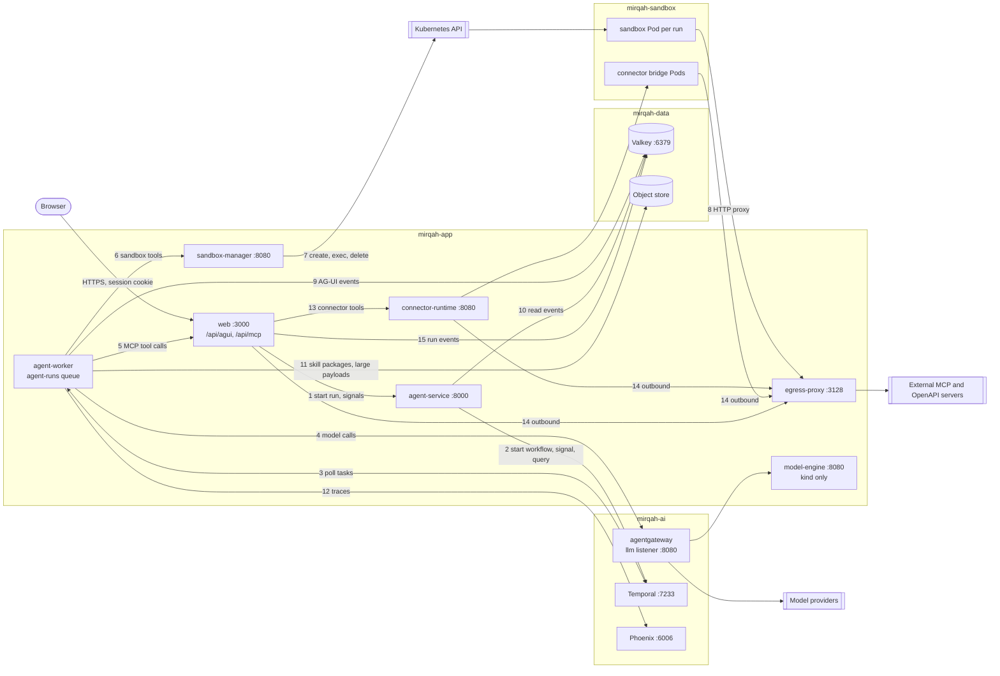
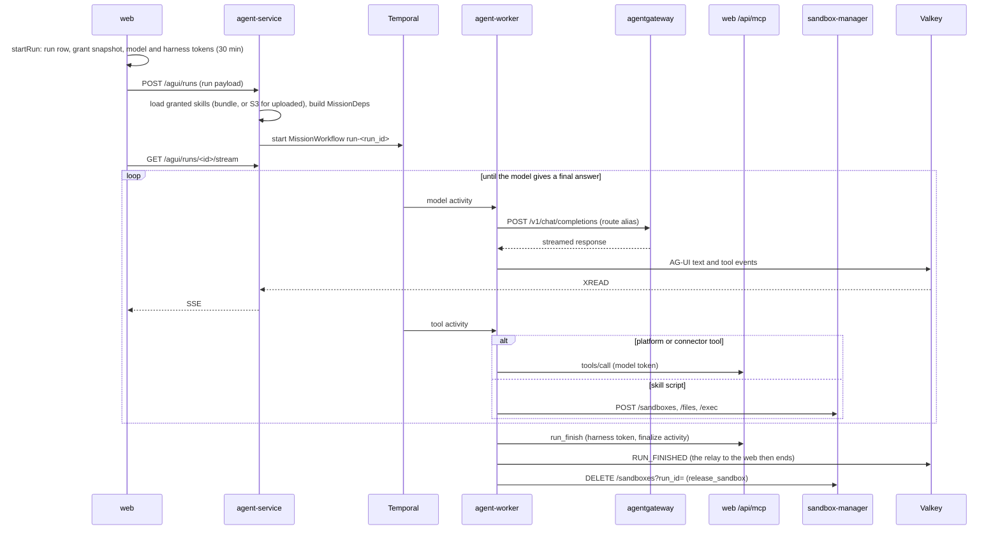

# Agent communication

| Item | Value |
| --- | --- |
| Purpose | Who calls whom when an agent runs: protocol, address, credential and network rule for each hop, centred on the agent runner |
| Audience | Developers, architects, operations |
| Related | [Architecture overview](overview.md) · [Solution design](solution-design.md#agent-path) · [AI platform](ai-platform.md) · [Security](../06-security/security.md) · [Agent runtime](agent-runtime-spec.md) |
| Last verified against code | 2026-10-29 |

The **agent runner** is the `agent-worker` Deployment on the `agent-runs` Temporal task queue. It
runs `MissionWorkflow` and its activities (`services/agent/src/mirqah_agent/mission/runtime.py`). The
`agent-service` API process starts missions and relays their events; it does not run them.

## Map

## Hops

| # | From → to | Protocol and address | Credential | Network rule | Code |
| --- | --- | --- | --- | --- | --- |
| 1 | web → agent-service | HTTP, `AGENT_SERVICE_URL`: `POST /agui/runs`, `GET /agui/runs/{id}/stream`, `POST …/approve`, `…/answer`, `…/cancel` | None checked. The start call sends the model token as `Authorization: Bearer`, which the agent service does not read; the run payload carries the two run tokens, and the `approve` and `answer` bodies carry fresh ones (D251) | `app-internal` (any Pod in `mirqah-app`) | `apps/web/src/features/agents/run-start-service.ts`, `lib/agent-runs.ts` |
| 2 | agent-service → Temporal | gRPC, `TEMPORAL_ADDRESS` (`temporal-frontend.mirqah-ai.svc:7233`), namespace `mirqah` | Payloads AES-GCM encrypted (D81, D204); a payload of 32 KiB or more goes to the object store with a reference in the history (D287) | `app-to-data-ai-and-gateway` | `services/agent/src/mirqah_agent/api/runs.py`, `worker.py` `data_converter` |
| 3 | agent-worker ↔ Temporal | gRPC long poll on `agent-runs` | As 2 | As 2 | `worker.py` |
| 4 | agent-worker → agentgateway | OpenAI chat completions, `AGW_LLM_URL` + `/v1` (`ai-gateway.mirqah-ai.svc:8080`), `model` = the run's route alias | `Authorization: Bearer <model token>`; the gateway does not validate it | `app-to-data-ai-and-gateway`, `ai-ingress` | `mission/runtime.py` `_model_for`, `clients/gateway_client.py` |
| 5 | agent-worker → platform MCP server | MCP Streamable HTTP, `PLATFORM_MCP_URL` (`web.mirqah-app.svc:3000/api/mcp`) | Model token for the model's tools; harness token for plumbing | `app-internal` | `mission/runtime.py` `_platform_tools`, `clients/platform_mcp.py` |
| 6 | agent-worker → sandbox-manager | HTTP JSON, `SANDBOX_MANAGER_URL` (`sandbox-manager.mirqah-app.svc:8080`): `POST /sandboxes`, `/exec`, `/files`, `DELETE /sandboxes?run_id=` | None; the sandbox is keyed by run id | `app-internal` | `mission/sandbox.py`, `services/sandbox/src/mirqah_sandbox/main.py` |
| 7 | sandbox-manager → Kubernetes API | Pod create, list, delete; exec over WebSocket | Service account `sandbox-manager`, Role on `mirqah-sandbox` only (get, list, watch, create, delete) | `apiserver-egress.yaml` | `services/sandbox/src/mirqah_sandbox/manager.py` |
| 8 | sandbox Pod → egress proxy | HTTP proxy, `HTTP_PROXY`/`HTTPS_PROXY` = `egress-proxy.mirqah-app.svc:3128` | None; no service-account token is mounted | `sandbox-egress-proxy-only` | `services/sandbox/src/mirqah_sandbox/spec.py` |
| 9 | agent-worker → Valkey | `XADD run:<run_id>:agui`, about 5,000 events kept for 6 hours after the last; a publish is bounded at 2 seconds and never fails the mission (D121) | `VALKEY_URL` | `app-to-data-ai-and-gateway` | `clients/events.py`, `mission/stream.py` |
| 10 | agent-service → Valkey → web | `XREAD` relayed as server-sent events to `/api/agui/[agentCode]` (then CopilotKit and the browser) and to `/api/integrations/[clientCode]/agui`; the relay ends after `RUN_FINISHED` or `RUN_ERROR` (D270) | As 9 | As 9 | `api/runs.py`, `apps/web/src/app/api/agui/[agentCode]/route.ts` |
| 11 | agent-service, agent-worker → object store | S3 API, `S3_ENDPOINT`: the bucket a skill's `package_ref` names (`skills`), and `run-payloads` for large Temporal payloads (D287) | `S3_ACCESS_KEY`/`S3_SECRET_KEY` | `app-to-data-ai-and-gateway` | `mission/skills.py` `fetch_package`, `temporal/storage.py` |
| 12 | agent-worker → Phoenix | OTLP over HTTP, `OTEL_EXPORTER_OTLP_ENDPOINT` (`phoenix.mirqah-ai.svc:6006/v1/traces`) | `PHOENIX_API_KEY` when set | `app-to-data-ai-and-gateway` | `tracing.py` |
| 13 | web → connector-runtime | HTTP JSON, `CONNECTOR_RUNTIME_URL`: `PUT /connectors` (the registry, with each remote MCP connector's credential headers, held in memory only, D296), `GET /mcp/{code}/tools`, `POST /mcp/{code}` | None | `app-internal` | `apps/web/src/lib/connector-runtime.ts` |
| 14 | web, connector-runtime, bridge Pods → internet | HTTP via the egress proxy (`EGRESS_PROXY_URL` in the web app, `HTTP_PROXY`/`HTTPS_PROXY` in the connector runtime, D297), domain allow-list in the proxy; the local kind cluster lets every destination through (`egressProxy.allowAll`, D297) | Each target's own credential | `egress-proxy-to-internet` (only the proxy leaves the cluster) | `apps/web/src/lib/egress.ts`, `services/connectors` |
| 15 | web → Valkey | `XREAD` on a connection of its own per follower, for `/api/sse/runs/[runId]` (the run viewer and a room's streaming reply) and the widget stream (D161, D350) | `VALKEY_URL` | `app-to-data-ai-and-gateway` | `apps/web/src/lib/sse.ts`, `apps/web/src/lib/valkey.ts` `runEventReader`, `apps/web/src/features/engage/widget-stream.ts` |

agentgateway leaves the cluster directly under its own rule, `agentgateway-egress`, and reaches the
local model engine on port 8080 in `mirqah-app`. It does not use the egress proxy.

## One mission

Approvals, questions and delegation pause the workflow and resume it by Temporal signal. Their
flows are in [solution design](solution-design.md#key-flows).

## Agent runner and agentgateway

- **Model.** Each run builds its own `OpenAIChatModel` for its route alias, with
  `base_url` = `AGW_LLM_URL/v1` and the run's model token as the API key (`_model_for`). Nothing
  is cached across runs, so one run's token never reaches another run's calls.
- **Routing.** The web app renders each route as `AgentgatewayModel` resources
  (`apps/web/src/agentgateway/render.ts`): one `Internal` model per chain step and one alias whose
  `virtualModel.failover` lists the steps in priority order. An agent can ask only for the alias,
  so it cannot skip the chain.
- **Provider credential.** A step that authenticates by header gets an auth policy pointing at
  Secret `mirqah-ai/agentgateway-providers`. The gateway sets the provider's `Authorization`
  header, so the provider key never reaches the worker.
- **Bounds.** A model activity has a 10-minute timeout and 4 attempts (D137).
- **Other callers of the same listener.** Request classification (`POST /classify/request`, route
  `classifier-typed`), a room's choice of agent (`POST /classify/agent`, Decision route
  `agent-choice`, D290), the handoff `finalize` writes when the agent wrote none (D140), and
  ingestion (embeddings and Graphiti) call the same listener with route aliases and
  `MIRQAH_RUN_TOKEN` as the API key.

## Agent runner and the platform MCP server

- The model's tools are an `MCPToolset` over Streamable HTTP with the run's model token
  (`_platform_tools`). A run granted no platform or connector tool opens no connection.
- The server re-checks every call: the grant in the token (D30), the person's permission (D31),
  the approval binding for T2 calls and for calls it escalates per field (D49, D58), and the room
  read floor for the model token's reads (D104); the harness token's plumbing is not floored
  (D360). A platform refusal reaches the harness as `PlatformMcpError`. For a connector tool it reads the tool's stored tier, so a T3 tool, or a
  T0 or T1 tool the agent's mode sets to Approval, has no server backstop
  ([spec conflict 12](agent-runtime-spec.md#-unresolved-conflicts-with-the-code)).
- A server `approval_required` refusal pauses the mission like a T2 call, and the approved
  retry presents the approval as `__approval` (D139).
- Connector tools are listed by the same server as `<connector>__<tool>` and forwarded by the web
  app to `connector-runtime`, or for an OpenAPI connector called through the egress proxy (D223,
  D234). The worker never calls a connector directly.
- Plumbing goes over the harness token from activities, never from the model:
  `approval_create`, `agent_question_create`, `run_start` for a child mission,
  `run_token_refresh`, `run_finish` (D33, D43). The harness token works only for its own run (D52).
- `generate_document` and `workspace_file_save` save files with `artifact_create` on the model
  token, so the server checks the person and the grant on the save (D131). A `generate_document`
  call that does not match its JSON schema goes back to the model as a retry before anything
  renders (D355).
- Bounds: a platform tool call has a 2-minute timeout and 3 attempts; the harness's own tools
  (`generate_document`, `write_handoff`) 5 minutes and 3 attempts (D250); raising an approval or
  a question, registering a child mission and refreshing credentials 2 minutes and 3 attempts
  (D193); `finalize` 2 minutes and 5 attempts (D123, D137).
- Credentials: while the agent works, the workflow calls `refresh_credentials` on the harness
  token 25 minutes after the tokens were minted and replaces them; the `approve` and `answer`
  signals carry fresh tokens too (D82, D251).

## Agent runner and the sandbox

A skill's scripts never run on the worker, because the worker holds the platform's credentials
(D209).

1. The first sandbox tool call of a run sends `POST /sandboxes {run_id}`. The manager returns the
   run's Pod while it is running, or creates one in `mirqah-sandbox`.
2. The worker copies each granted skill that ships a script into `/workspace/skills/<name>/`:
   it reads an uploaded skill from the object store and a bundled one from `/app/skills`, then
   writes each file as base64 through `POST /sandboxes/{id}/files`. A marker file records that the
   copy finished, so a copy that was cut short is made again.
3. `skill_script_run` runs only a script the skill ships, through `POST /sandboxes/{id}/exec`,
   for at most 120 seconds. The manager runs the command with Kubernetes exec over WebSocket.
4. `workspace_file_read` and `workspace_file_save` read files back as base64; the save goes on
   to `artifact_create` over MCP.
5. When the mission ends, the `release_sandbox` activity deletes the run's Pods. The Pod's own
   15-minute deadline ends it otherwise.

The Pod has no service-account token, a read-only root filesystem, every capability dropped, and
runs on the `sandbox` node pool. Its only way out is the egress proxy. A 404 or 5xx from the
manager reaches the model as "the sandbox is not available" rather than failing the mission
(D212). A sandbox tool call has a 6-minute timeout and 2 attempts.

## Gaps between design and code

| Gap | Effect |
| --- | --- |
| agentgateway validates no JWT and applies no policy; its MCP listener (`:8081`) and A2A role have no caller | The run token sent to the gateway is not checked there. Grants and approvals are enforced only by the platform MCP server |
| The `x-mirqah-mission-id`, `x-mirqah-run-id` and `x-mirqah-person-id` headers and the OpenAI `user` field are set only by `gateway_client.call_settings`, which nothing calls, and not by `_model_for` | Gateway logs cannot group a mission's model calls (D75, spec conflict 4) |
| sandbox-manager has no authentication | Any Pod in `mirqah-app` can create, exec in or delete sandboxes |
| The sandbox-manager Role has no `patch` on Pods, which claiming a warm Pod needs | Every run starts a cold Pod (D209) |
| The mission path records only the `run:end` span, which carries no `mirqah.mission_id` | Phoenix has no model or tool spans for a mission (spec conflict 11) |
| Nothing publishes `RUN_ERROR`; `finalize` publishes `RUN_FINISHED` after `run_finish` | A mission whose `finalize` activity fails every attempt leaves its stream open until the reader gives up |
