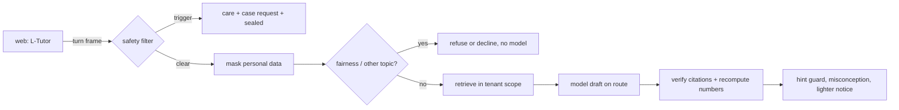

# Agent runtime specification

| Item | Value |
| --- | --- |
| Purpose | The target behaviour of the one agent runtime every agent runs on, and where the code does not yet match it |
| Audience | Developers, architects, the owner |
| Related | [Decision register](../03-decisions/harness-decisions.md) · [AI platform](ai-platform.md) · [Solution design](solution-design.md#agent-path) · [Security](../06-security/security.md) · [Agents and runs module](../01-product-requirements/specs/aic/agents-and-runs/README.md) |
| Last verified against code | 2026-11-02 (see [the conflicts](#-unresolved-conflicts-with-the-code)) |

The target behaviour of the platform's agent runtime. This describes where the
platform is going, not where it is today; a section is only true of the running
system once its decisions in [the register](../03-decisions/harness-decisions.md) read **Done**.

Every agent on the platform runs on this one runtime: the built-in Platform
Assistant and every user-defined agent. An agent takes the user's prompt as its
goal and works in a loop, planning, calling tools, loading skills, using models and
asking for approval where required, until the mission finishes or the user
terminates it. All agents behave the same way. The only difference is that the
Platform Assistant is seeded as a built-in agent that cannot be deleted.

## 1. One runtime

One generic agent definition runs every agent (D64). Per run it is configured from
the agent's stored configuration: instructions, model, granted tools, skills,
knowledge, memory scope, budgets.

Under Temporal, agents and toolsets have to exist at worker start, and user-defined
agents are created at runtime. Configuration is therefore resolved per run,
deterministically from the run's deps — by library mechanisms, not by code of ours (D83).

Verified against the installed versions (`pydantic-ai` 2.57.0, `pydantic-ai-harness` 0.57.0,
`temporalio` 1.34.0):

| Needed per run | Mechanism |
| --- | --- |
| The model | `ResolveModelId` — builds an `OpenAIChatModel` per run for the run's route alias at agentgateway, with the run's model token as the API key (`_model_for` in `mission/runtime.py`) |
| The tools | `DynamicToolset(toolset_func, id="…")` — built from the run context, with the stable id Temporal needs. The platform MCP server lists the granted connector tools too, as `<connector>__<tool>` (D223) |
| The grant | `FilteredToolset(wrapped, filter_func)` — `filter_func` reads the grant off the deps, so the model is offered exactly it (D37) |
| Which calls pause | `ApprovalRequiredToolset(wrapped, approval_required_func)` — pauses a call whose catalogue tier is T2; a wrapper toolset turns the server's `approval_required` refusal of a call it escalated per field into the library's `ApprovalRequired` (D58, D84, D139) |
| Instructions | built from deps: the agent's instructions and the organisation's rules, each granted skill's name and description (its body is loaded with `skill_load`, D377), the sandbox note when a granted skill ships a script, then the mission's frame (the person's language, the record it is about by key, the acceptance criteria, the conversation so far) (D127, D130, D137, D162) |
| Harness-answered built-ins | `FunctionToolset` — `generate_document` saves the file as an artifact of the mission's record; `write_handoff` ends the mission BLOCKED (D131) |
| Skill scripts | `FunctionToolset` — `skill_script_run` and `workspace_file_*`, in a sandbox Pod of the run's own (D209) |
| Effort limits | `UsageLimits` across the whole mission, carried over each pause (D129); none unless the platform sends one (D389) |
| Context and cost | `ClearToolResults`, then `SummarizingCompaction` at a high threshold; tools above READ deferred behind `ToolSearch`; tool retries 6 (D380); bounded model and tool activities, the harness's own tools included (D137, D250) |
| Durability | `TemporalDurability`, with the stream handler of section 2 and the bounded activity configurations above |
| Planning, guardrails, budgets | `Planning`, `pydantic_ai_harness.guardrails`, and `pydantic_ai_harness.spend` with `RedisSpendStore` (D85). None is composed yet (conflict 4) |
| History size | Temporal's `ExternalStorage` with its S3 driver: a payload of 32 KiB or more is kept, encrypted (D81), in the `run-payloads` bucket and the history holds a reference, so a long mission stays under Temporal's 50 MB history limit (D287) |

So one `Agent`, `mirqah-mission`, constructed once, configured per run from its deps. The
platform has no loop, approval pause or tool filter of its own (D01, D120).

What stays ours is the boundary, not the plumbing: the grant in the token, the run-row
snapshot, the approval binding and its atomic claim, and the server-side escalation. The
library decides that a call pauses; only the server decides that a person agreed to this
exact payload against this record version (D84).

## 2. The mission loop

A user prompt starts a mission. Mission id = the run id of the run a person started; its
Temporal workflow is `run-<run_id>` and its trace id is the run id (D44).

The agent plans (`Planning`, with a persistent store, not yet composed: conflict 4), calls granted tools, follows its
granted skills, uses its configured model, delegates within limits, and continues until it
reaches one of the outcomes in section 3. A pause for a person (an approval, a question, a
delegation) resumes the same conversation with the usage so far (D128).

Granted skills are read before the mission starts. The instructions list each by name and
description; the model loads one with `skill_load`, which returns its body and the files it ships,
and opens a file with `skill_file_read`, passing a link as the `SKILL.md` writes it: `#anchor`
returns that section only, `../other-skill/…` a file of another granted skill, and only a file the
package lists is read. Both come with any granted skill rather than a grant, and run as activities
of their own toolset (`mission/skill_files.py`, D377); the library's `load_capability` cannot run
under Temporal in pydantic-ai 2.57 (D127). A bundled skill is read from the bundle the image carries. An organisation's uploaded
skill is copied by the API process from the object store into a temporary library, bounded at the
import's 5 MB and 200 files and refused if a key leaves the package, and read by the same loader.
The platform sends a pinned skill only when its version is Published and, for a skill that is not
bundled, its security scan passed (`whyNotApplied` in `apps/web/src/lib/skill-package.ts`); the
agent's Skills tab says why any other is not applied. A skill that cannot be fetched or loaded is
left out and logged, and the run goes on (`services/agent/src/mirqah_agent/mission/skills.py`).

A skill's scripts run in a sandbox Pod the sandbox manager gives the run alone, never on the
worker (D209). The model runs only a script a granted skill ships, with `skill_script_run`, and
writes its input, reads files back and saves the result as an artifact with the
`workspace_file_*` tools; it cannot write into `skills/`. The skill's files are copied into the
Pod on first use and the Pod is deleted when the mission ends
(`services/agent/src/mirqah_agent/mission/sandbox.py`).

The agent may ask the person it works for a clarifying question with `ask_person`, when its
grant includes it (D125). Raising a question or an approval publishes the contract's
`mirqah.agent.question` or `mirqah.tool.approval` event (`mirqah.tool.confirmation` for a call the server
escalated) on the run's stream, so the assistant panel shows
what the run waits on (D239). A question offers its answers as `options`, or asks for several
values as `fields`, which the panel draws as a form (D252). Each tool call and its result reach the
panel as AG-UI's own tool-call events, which it lists as the turn's steps (D252). The call is deferred to the mission workflow, which records the
question in the person's Inbox through `agent_question_create` on the harness token, waits up
to 24 hours for the `answer` signal, and resumes with the answer as the tool's result, or with
"nobody answered the question in time". While it waits, the workflow's `status` query reports
Waiting; its `steps` query lists the approvals, questions and delegations so far.

### 2.1 The brief of a work item or request (D384)

A run started on a work item or a request (surface `WorkItem` or `Request`) does not rely on the
agent's platform tools to learn the record. The console builds a brief before it starts the run
(`withBrief`, `features/agents/brief.ts`; the record's part in `work-items/brief-service.ts` and
`requests/brief-service.ts`, read from the primary database) and sends it as the prompt after what was
asked: the record's facts, description, fields, sub items, comments and history with who and when, the
last 20 audit entries and its attachments by name. When the run finishes, `finishRun` posts the answer
on the record as the agent's comment (`agentAnswerOf`).

D385: for a request step, `finishRun` first takes the decision a Succeeded run returned
(`applyAgentDecision`, `requests/step-decision-service.ts`), while the run row is still live so the
step's audience rules (`boundAgent`) see the agent, under the person behind the run. It is skipped when the
output is no decision, the action is not offered at the current step, or the request was moved since the run
started (the agent may have taken it with `request_step_action_create`). A decision taken is not posted again
as a comment.

## 3. Outcomes

The run statuses are `RunStatus` in `harness/types.py` and `RUN_STATUSES` in the web app's schema.

| Outcome | Run status | Meaning |
| --- | --- | --- |
| SUCCEEDED | Succeeded | A non-empty final answer and no handoff. For request steps, the output matches the step schema. Verified in code, not asserted by the model (D40, D41). Plan items are not checked, because no plan exists (conflict 4). |
| BLOCKED | Blocked | Blocker recorded through `write_handoff`; lands in a human queue (D42). A run status of its own, because a blocked run left in the resumable queue is one nobody acts on (D101). |
| Waiting on an approval | Waiting | Waiting on a bound approval; the approval row says what it waits on (D101). Resumes on the `approve` signal. |
| Waiting on a question | Waiting | Waiting on an answer from the person; the question row says what it waits on. Resumes on the `answer` signal. |
| BUDGET_EXCEEDED | BudgetExceeded | An effort limit (`max_steps` or `max_tool_calls`) the platform sent was hit; it sends none, so runs since D389 do not end this way. There is no money ceiling (D73). The mission ends; it is not resumed. |
| CANCELLED | Cancelled | The user terminated the mission (D67). |
| FAILED | Failed | An empty answer, an unmet step contract, an unhandled failure, a failure raising an approval, question or child mission (D193), or more than 20 approval rounds (D89). |

The model can never end a mission itself: `run_finish` is harness-only (D33, D43), and
the outcome is the platform's judgement after the run rather than anything the model
wrote — an empty answer is FAILED, a handoff is BLOCKED, an exhausted effort limit is
BUDGET_EXCEEDED, and for a request step the declared contract has to be met (D102, D115).

The outcome reaches `run_finish` even when the context handoff cannot be written. When the
agent wrote none, `finalize` asks the mission's route to write one from the final answer
(D140), bounded at 60 seconds; a room run's is built from its answer without a model call,
because the room's reply waits on it (D351); a route that refuses or does not answer, often the one that
just failed the mission, leaves a handoff carrying only the task's title
(`harness/activities/finalize.py`).

## 4. User termination

The requester, the room owner (in rooms) or an admin can terminate a mission (D67).

Terminating cancels the mission workflow: the in-flight model or tool call is
cancelled, child missions are cancelled, pending approvals and questions are voided,
and no further tool calls run. The agent reports what it completed before
cancellation. The status is CANCELLED, which is never reported as done. Child missions and
the report are not yet built (conflict 13).

## 5. Approvals

Tool tiers are T0 (read, free), T1, T2 (approve) and T3. The tier is the platform
catalogue's, or a connector tool's stored tier, raised to T2 when the agent's mode for the
tool is Approval. The runtime pauses a T2 call before it runs (`APPROVAL_TIERS` in
`mission/runtime.py`). A T1 call runs, unless the server escalates a field it touches, from
the sensitivity table in each feature's `privileges.ts` (D58), and then pauses (D139). T3 has
no behaviour of its own (conflict 12).

The approver is the person who started the mission (D19). In a room that is the
person who asked the agent, never another participant and never another agent; in the
assistant panel it is the person asking, for every call including one that changes who may
reach what, who approves it there, rejects it, or asks for changes with a note the agent acts
on, or has it approved as it arrives (approval mode Auto). Outside those two, and for a room
call that changes who may reach what, the approvers are the other holders of
`approvals:decide` (D253, D281, D282, D284, D285).
Sub-agent and delegated-agent approvals always go to that same human (D18).

An approval binds to tool + canonical args hash + record version + mission + person;
it expires; it is single use; and the cascade is shown and bound to it (D20, D21,
#24).

A server `approval_required` refusal becomes a pause: the harness creates the bound
approval, suspends, and retries the same call once it is approved. This is safe
because the server checks before writing, so a refused call wrote nothing (D49).

Separation of duties on a request is one such escalation. An agent acting for the requester
that takes an approve action on the request's step is refused with `approval_required` on
`action`; the approval goes to the holders of `approvals:decide` other than the requester,
and the approved retry moves the request with the approval named in its history (D141). A
step that names the requester, as a person, among its "Can act" audiences lets them approve,
and their agent with them, without that escalation (D217).

An approval nobody decides within the 24-hour pause is a denial the mission is told about,
not a failed mission: the model reads that nobody approved the call in time and carries on
without it (D126).

## 6. Permissions and grants

The model token (granted tools) and the harness token (plumbing only) stay separate
(D33).

The grant is recorded on the run row, `ai.run.granted_tools` (D35). A child's grant =
the parent row AND the child agent's configuration (D36). A resume's grant = the
current configuration AND the snapshot: it can shrink, never grow (D50).

The model is only shown the tools its token grants (D29, D37). Refusals carry reason
codes, `user_permission`, `agent_grant`, `approval_required`, `run_binding` or
`room_read_floor`, so the agent can explain them to the user (D32, D69, D104).

A run's live event stream carries the model's text, so it is given only to the person who started the
run, to somebody holding `agents:read` (D124), and, for a run in a room, to whoever may read the
room, where the reply streams as it is written (D161).

## 7. The built-in Platform Assistant

Seeded by an idempotent seed with a fixed, stable key, `is_builtin = true` (D65).

It cannot be deleted or removed from the platform: the server refuses and the UI
hides the action.

It is configurable: skills, tools, knowledge, memory, model, budgets and extra
instructions, through the configuration screen of section 9. Editing it requires
`agents:configure` as well as `agents:write`, checked in the service rather than only in
the UI (D100, D117).

Not removable: core safety instructions, the approval gate, and the effort limits.
Lowering a limit is allowed; raising one needs the privilege. There are no money
ceilings to remove (D73).

"Reset to defaults" restores the seeded configuration. Seed upgrades update the
defaults without overwriting user customisations, tracked by a default version.

It holds the agent tools (`agent_create`, `agent_tool_grant_edit` and the rest) by default,
an exception to D63: each is T2, decided in the panel by the person asking and in a room by
somebody else (D253, D254, D284).

The AI Assistant panel always runs this agent, in the Console context. There are no setup
tools and no hand-off to another agent: the Setup Director is removed (D371).

## 8. User-defined agents

Same runtime, same loop, same outcomes, same approvals (D64).

Configured through the agent configuration screen (section 9, D38). T2 tools are grantable only once #24 lands, and then with a
warning (D63). They run as the person who invoked them: user permission AND agent
grant (D31).

## 9. Agent configuration screen

Tabs per agent covering the tool grant, skills, knowledge-base access, memory settings,
the model route and budgets (D38). The tool grant is one tab, Connector tools: one record
per connector, the built-in Platform connector first, each opening onto its granted tools
with a remove control. The Platform connector's tools are the platform tools and the
harness-answered built-ins, read from the catalogue and granted through
`ai.agent_platform_tool`; another connector's tools carry a mode for the agent. Add offers a
Platform tool, one tool of a connector, or every tool of a connector, a read at Auto and any other at Approval (D228, D264).

A connector keeps no list of allowed agents. A run reaches every enabled connector, narrowed
by its project's allowed connectors, and is offered the tools its agent version grants; the
MCP server checks the grant again on each call (D30, D227).

The approval-class warning reads each tool's tier from the platform catalogue, and the
"this skill declares a tool the agent is not granted" check runs `grantedToolNames()` —
the same function the run token uses. Neither keeps a second list.

Every agent version was migrated to an explicit copy of what it reached before, including
the five harness-answered built-ins, so the grant became real configuration without any
agent losing a capability (migration 0034, D80).

A tool that changes an agent's configuration or grant (`agent_create`, `agent_edit`,
`agent_tool_grant_edit` and the rest) is T2, and its approval goes to the holders of
`approvals:decide` other than the requester, in a room too, so a person other than the one
asking reads the exact payload (D253); in the assistant panel the person asking decides it
(D284). No tool changes a role, a privilege or a credential
or invites a person, and a test fails on one (decision (e), D108).

## 10. Memory

Scoped per (agent, person) by a `person_id` on the scope row; rooms have their own room
memory, readable by that room's members (D68, D116). Never shared across people.

A run's write path derives the scope from the token's agent and the acting person. There
is no argument the model can set to move it, which is the difference between a rule and a
request. A person can view and clear their own memory, and `clearMyMemory` takes no
argument — the person comes from the session straight into the WHERE clause.

Memory has one write per subject. `memory_propose` is gone: it called the same service
with the same arguments as `memory_write`, and two names for one action cannot both be
described honestly to a model (D116).

## 11. Discussion rooms

The Assistant and user-defined agents can be added to a room by room members with
permission (D66).

An agent acts only when a person addresses it, by mention or assignment. Each
address starts a mission whose requester is that person. One agent acts on a message,
however many are in the room: the first named or, in an Autonomous room, the one the
Decision route `agent-choice` chooses for a message that names nobody, the lead when it
cannot (D213, D289, D290).

No agent-to-agent ping-pong: an agent never triggers another agent's mission by
posting. Agent-to-agent work happens only through delegation inside a mission. The
number of agent messages per human message is limited.

A room's own limit is agent turns per human message, not money (D106). Approvals go to
the requester only; other members see "awaiting approval".

Visibility is settled as option (a) (D104). An agent's **reads** inside a room are
bounded by what every human member may see — the least-privileged member — because the
answer is posted to all of them, and one member's question must not become another
member's data leak. **Writes** are the requester's permissions intersected with the
agent's grant, plus approval. The one read the floor does not bound is `knowledge_search`: it
reads only the collections the agent is granted on its Knowledge tab, bounded by that grant and
the requester's own permissions (D291).

The floor is a list of whole principals, resolved per call from the run row, installed by
the MCP server on read-class calls and applied by conjunction in the one function that
answers "may this principal do this, here". Not merged grants: `evaluate` already resolves
explicit deny and the org-unit hierarchy, and each person's path differs. Not a token
claim: room membership changes while a mission runs.

Approvals in a room go to the requester, and only them, who decides them without needing `approvals:decide` (D105, D269); so do the
assistant panel's, access changes included (D281, D284). Elsewhere, and for a room call that changes who may reach what, the platform's separation of duties stands.

Any agent may be removed from a room by a
member with permission, the Assistant included — D65 protects its existence on the
platform, not its membership of a room (D107).

## 12. Delegation between agents

Delegation goes through the workflow-intercepted `delegate_to_agent`, offered only when
granted, which starts a child mission workflow. The harness's `SubAgents` is not composed:
it offered `delegate_task` outside the grant (D142). The child's grant is a subset of the
parent's, the budget is shared, the requester is the same, and the approval rules are the
same.

Limits: depth (2 hops below the mission a person started, refused in
`registerDelegatedRun`, D142), fan-out per parent and
concurrent (D15), and a shared tree budget (D11, conflict 14).

## 13. Limits

Neither effort nor cost bounds a run since D389: it carries on until it finishes, a person
cancels it, or a failing tool stops it. Cost is counted, never enforced.

There is no money ceiling (D73): `soft_cost_aed`, `hard_cost_aed` and `room_cost_cap_aed`
are gone from `RunBudget`, and the budgets the harness keeps carry no limit at all. A
mission stops when the work is done, when a person stops it, or when it hits an effort
limit the platform sent — not part-way through correct work because an estimate crossed a
number.

| Limit | Value |
| --- | --- |
| `max_steps` / `max_tool_calls`, conversational | 40 / 200 |
| `max_steps` / `max_tool_calls`, task | 60 / 300 |
| `max_steps` / `max_tool_calls`, planner | 40 / 100 |
| `RunBudget` defaults | none / none (D389; 60 / 300 before) |
| `agent_hop_limit` (delegation depth) | 2 hops below the mission a person started, refused in `registerDelegatedRun` (D15, D142) |

The profile numbers are sized to be reached by a model that has lost the thread, but no run
uses them: the platform sends no limits and, since D389, `RunBudget` has none of its own.
RUN-88199 was stopped by the old default at its 60th model request while still creating a
request type's steps, which is real work, not a runaway. When a limit is sent it is the
library's `UsageLimits` (`request_limit` = `max_steps`, `tool_calls_limit` = `max_tool_calls`),
applied across the whole mission and carried over each pause (D129), and a run that exhausts
it ends BUDGET_EXCEEDED, never SUCCEEDED (D93). `effort_limits` always passes both, None
included, because the library's own default stops a run at 50 requests.

What stops a model that has lost the thread is now the repeated-failure guard below, Cancel,
and the delegation depth. A model that keeps calling tools that succeed, without finishing,
runs until somebody cancels it; a very long run also grows its Temporal history toward the
server's limit, which ends the workflow.

A tool that keeps failing is stopped before the budget is reached (D379). A tool that raises
(an MCP `isError`, a refusal) is the library's: six retries, then the run fails (D137, D380). A
tool that answers that it failed (`success` or `ok` false) is not an error to the library, so
`RepeatedFailureGuard` (`mission/failure_guard.py`) counts those answers in the run's own
messages, back to that tool's last success: after three in a row it answers the fourth call
without making it and tells the model to stop and report the last error, and a model that
calls it again ends the run Failed. A connector's refusal reaches the model as the tool's own
text, up to 4 000 characters (`connectorRefusal` in `apps/web/src/lib/connector-runtime.ts`).

Cost is counted by `pydantic_ai_harness.spend` on a shared Valkey key scoped to the
**mission**, so a delegation tree accumulates against the parent (D11, D92). Pricing is
the platform's own per-1000-token estimate (`estimate_cost_aed` in `clients/gateway_client.py`),
because a route is an agentgateway alias no price list can resolve. AED converts to USD at
3.6725. A delegated run therefore reports the mission's running total rather than its own
(D94). None of this is wired yet (conflicts 4 and 10).

Depth alone does not bound a tree, so delegation also has fan-out limits: 8 delegations per
run and 3 in flight, counted from the run rows and refused in the server
(`apps/web/src/features/agents/delegation-service.ts`, D15, D103).

## 14. Observability

The mission id is threaded to Phoenix, the agentgateway header and the OpenRouter
session field (D44). The OpenRouter `user` field is the real platform user (D45).
Sub-agent and child missions carry `parent_run_id`, so traces form a tree (D46).
Every write is audit-logged with its mission id (D26).

## 15. Tool catalogue convention

Tools are named `<subject>_list/_get/_create/_edit/_delete/_publish` (D61). There is
one partial edit per subject: strict, at least one field, null clears, with
`expectedVersion` in the SQL WHERE, applied atomically, returning a before/after diff
plus the cascade (D55, D56, D59).

`privileges.ts` holds field to privilege and sensitivity; `fieldRulesTable()` renders
it for review before each module is coded (D57).

Sensitive fields on an agent call need a bound approval. A rule may name the values that
need one rather than the whole field: a work item moving to `Done` or `Cancelled` waits
for a person, moving along the board does not, because a queue of approvals that are
nearly all routine is approved without being read (D109). Fail closed — a value the rule
cannot read still waits.

T2 tools exist in the catalogue and are grantable per agent, off by default (D63 as
satisfied by #24). Connectors are managed through the catalogue, each write that widens what
agents reach (create, import, edit, enable, a tool's tier) T2 and decided by somebody other than
the requester outside the assistant panel (D284), and no tool takes a credential, which a person types in the console (D277).
Integrations and channels are read-only, because their writes carry credentials and permissions
(D108). Deployments, storylines, rooms and schedules have tools; what decides who reaches a
deployment escalates (D253).

## 16. The AI tutor (M-046, M-049)

The tutor is not a mission. A tutor turn is a synchronous request from the web
(`POST /api/v1/tutor/turns`, or `/turns/stream` as SSE; contract in
[tutor-api.md](../04-api-and-integrations/tutor-api.md)) answered by `mirqah_agent/tutor/` in one
pass, without a Temporal workflow: the student is waiting, and nothing in a turn needs to survive a
restart. Like a mission it reaches models only through agentgateway route aliases and reads no
domain database; unlike a mission it has no tools, no MCP and no instrumentation capability.

- **Safety first** (BR-AI-05, M-049). An English and Arabic pattern layer runs on every turn with no
  network call; an optional model layer (`MIRQAH_TUTOR_SAFETY_ROUTE`) can only add categories. The
  policy is the strictest of the platform and tenant layers; a layer cannot say
  "off". On a trigger the engine stops: care message naming the lead, help resources by market,
  `safeguarding_case_requested` as the first streamed event, turn `sealed`. No retrieval and no
  model call happen for that turn. Personal data is masked and noted, not a case.
- **Grounding** (BR-AI-01). Retrieval reads only the tenant's approved collections and its licensed
  ones (`ingestion/scoped.py`: per-collection query with the owner check in SQL, then a second
  check in Python, then a third in the engine). A segment keeps only citations of passages
  retrieved in this turn and is dropped without one; nothing left is "not sure". Every number the model declares is recomputed by `tutor/maths.py` (an AST
  evaluator with SI units, never `eval`) and corrected when wrong.
- **Help rules** (BR-AI-02/03/04, BR-ASM-04). `fairness` mode refuses without the model; a question
  naming another syllabus topic is declined with the nearest allowed topic as a plan offer; the
  hint ladder and the full-solution unlock follow the class rule; the assigned answer is removed
  from any segment while the work is graded.
- **Lighter mode** (BR-AIU-03). At ≥ 100 % of the usage limit the turn runs on
  `MIRQAH_TUTOR_LIGHTER_ROUTE` with a notice; the tutor never stops.
- **Tracing** (C-10). The tutor's model calls are not instrumented. A turn records one span with
  its shape (outcome, mode, route, counts); a sealed turn records nothing.

## ⚠ Unresolved conflicts with the code

Verified on 2026-10-29 by reading `services/agent` and `apps/web` at commit `68fff99`, against this
specification and the register. Paths in the Code column are relative to
`services/agent/src/mirqah_agent` unless they start with `apps/`. Each row is a place where the text, or a decision marked **Done**,
describes behaviour the running code does not have. The register is not rewritten
(`harness-decisions.md` is amended only by the owner's process), so these are listed here until each
is fixed in code or the decision is amended.

| # | Specified | Code | Affects |
| --- | --- | --- | --- |
| 3 | Effort limits per profile: conversational 40/200, task 60/300, planner 40/100 (§13, D73). | The runtime applies `max_steps` / `max_tool_calls` from `RunInput.budget` across the whole mission (D129), but the web app sends no per-profile values, so every run gets the `RunBudget` defaults, 60/300. Its `budget` carries `soft_cost_aed` and `hard_cost_aed`, which `RunBudget` does not declare and ignores (`apps/web/src/features/agents/run-start-service.ts`). | D73, D129 |
| 4 | Spend is counted by `pydantic_ai_harness.spend` on a mission-scoped Valkey key (§13, D85, D92); the mission id travels as `x-mirqah-mission-id` on every model call (§14, D75); PII is masked in the model-request activity (D110); the agent plans with `Planning` (§2). | `harness/spend.py` has no caller; the headers are set only in `gateway_client.call_settings`, which has no caller; `_model_for` in `mission/runtime.py` adds no headers; `build_agent` composes no guardrail, no `Planning`, and no spend capability; it composes the instrumentation since 2026-11-02 (conflict 11). Nothing on the mission path masks PII: `PiiMaskHook` is called only by ingestion's `parse_document`. Skills are applied (D127), not deferred. `Planning` cannot run under Temporal in harness 0.57: its tools call `ctx.emit`, which raises inside an activity (D137). | D40, D75, D85, D92, D110, D137 |
| 6 | The UI edge uses `pydantic_ai.ui.ag_ui.AGUIAdapter` (D98). | AG-UI events are built by hand: text and tool-call events in `mission/stream.py` (`publish_to_panel`, `_tell_progress`, `tell_panel`), `RUN_STARTED` in `api/runs.py` and `RUN_FINISHED` in `harness/activities/finalize.py`; `AGUIAdapter` is imported nowhere. | D98 |
| 7 | The bespoke components of the D96 audit are deleted as each surface moves onto the runtime. | The modules of R08 are deleted (D319). Still present: `harness/tools/builtin.py`, whose specs `mission/tools.py` and `mission/sandbox.py` read. Present with their tests and no caller on any entry point: `harness/skills/loader.py`, `harness/spend.py`, `gateway_client.call_settings`, and `safeguards`, `skill_capabilities`, `catalog` and `end_strategy` in `harness/capabilities.py`. Defined and registered on no worker: the `request_approval` and `ask_person` activities in `harness/activities/approvals.py` (the mission uses `mission/approvals.py` and `mission/questions.py`) and the `verify` activity in `harness/activities/verify.py` (the mission calls its `step_contract` only). Each is the mechanism conflict 4 or D127 names for its fix, so whether to wire or delete them is the owner's decision. | D96 |
| 10 | A finished mission records its tokens, tool calls, estimated cost and run-viewer timeline (§13, D92, D94). | `_record_outcome` in `mission/runtime.py` sends the tokens, executed tool calls, the final answer the handoff is written from (D128, D140) and the timeline built from the mission's messages (`mission/timeline.py`, D300), but not `estimated_cost_aed`, so cost reads 0; the run viewer does not show it (D300). A `PlatformMcpError` from `run_finish` is caught and reported as `recorded=False` without a retry (`harness/activities/finalize.py`), so D123's five retries apply only to other failures. | D92, D94, D123 |
| 11 | One trace per mission with model and tool spans, each carrying `mirqah.mission_id` (§14, D44). | The model and tool spans are recorded: `build_agent` composes `capabilities.instrumentation()` (Pydantic AI's `Instrumentation`, content included), and `_run_until_cancelled` runs the agent under `tracing.within_run`, so the agent run, each `chat` span with its prompt and answer (OTel GenAI attributes, shown by Phoenix as LLM spans) and each tool span carry the run id as trace id. The tracer is Temporal's replay-safe provider, so a replayed workflow does not record its calls again. Still missing: the `open_trace` activity is registered (`worker.py:73`) but never executed, and neither the agent's spans nor `run:end` carry `mirqah.mission_id`, so a delegation tree is several traces with nothing joining them. | D44 |
| 12 | Tiers T1 "Confirm" and T3 "Forbidden" (`TIERS` in `apps/web/src/features/connectors/types.ts`); the server refuses an APPROVE-class call with no bound approval (§5, D49). | A T1 call runs with no confirmation unless the server escalates it. T3 has no behaviour: a T3 connector tool can be granted (`LOOSEST_MODE` allows Approval, D264 grants it at Approval), `tierUnderMode` keeps it T3 rather than raising it to T2, the runtime pauses only T2 (`APPROVAL_TIERS` in `mission/runtime.py`), and the MCP server requires an approval for a connector operation only when its stored tier is T2 (`callConnectorOperation` in `apps/web/src/mcp/server.ts`). A granted T3 connector tool therefore runs with no approval. The server reads the stored tier, not the tier under the agent's mode, so a T0 or T1 connector tool granted at Approval is paused by the harness only, with no server backstop. A project's approval rules (`minimumTier`) are stored and read by no run path. | D49, D63, D264 |
| 13 | Terminating a mission cancels its child missions, and the agent reports what it completed (§4, D67). | `cancelRun` signals `cancel` to the mission's own workflow only (`apps/web/src/features/agents/service.ts`). While the mission waits on a child (`execute_child_workflow` in `_delegate`), the signal is not acted on until the child ends, and the child's run row stays as it is. A cancelled mission's output is a fixed sentence, not an account of its work. Pending approvals and questions are refused when somebody tries to decide them (`apps/web/src/features/inbox/service.ts`). | D67 |
| 14 | A delegation tree shares one budget (§12, D11). | Each child mission gets its own `UsageLimits` from the `MissionDeps` defaults, none since D389 (`mission/delegation.py`), and no counter spans the tree. | D11 |
| 15 | A knowledge collection is chunked with the chunk size its configuration saved (`UC-57.2`). | The web app sends `chunking.size` (`apps/web/src/features/knowledge/ingestion-service.ts`) and `ChunkingConfig` reads `chunk_size` (`ingestion/chunking.py`), so the size is ignored and every collection chunks at 1,200 characters with the saved overlap. The screens offer Fixed, Recursive, Semantic, SentenceWindow and TableAware (`apps/web/src/features/knowledge/components/`); `ChunkingConfig` accepts Fixed, Recursive, Semantic and ByHeading, so the agent service refuses an ingestion request for a SentenceWindow or TableAware collection (422). A new collection's chunking is stored under `strategy` (`createCollection` in `apps/web/src/features/knowledge/repository.ts`), which the reads ignore, so it reads and indexes as Recursive. | — |
