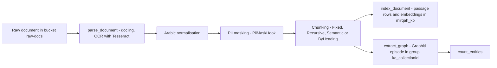

# AI platform components

| Item | Value |
| --- | --- |
| Purpose | How agentgateway, Temporal, Arize Phoenix, the knowledge stores, sandboxes, connectors and the local model engine are used |
| Audience | Developers, architects, operations |
| Related | [Architecture overview](overview.md) · [Agent runtime](agent-runtime-spec.md) · [Solution design](solution-design.md#agent-path) · [Tech stack](tech-stack.md) · [Knowledge module](../01-product-requirements/specs/aic/knowledge/README.md) · [Model providers](../04-api-and-integrations/model-providers.md) · [MCP connectors](../04-api-and-integrations/mcp-connectors.md) |
| Last verified against code | 2026-10-29 |

The agent loop itself, its outcomes, approvals, grants and limits are specified in
[agent-runtime-spec.md](agent-runtime-spec.md). This document covers the components around it.

## The agent service

`services/agent` is one image run as two kinds of process:

| Process | Command | Serves |
| --- | --- | --- |
| `agent-service` | `uvicorn mirqah_agent.main:app` (port 8000) | `POST /agui/runs` (start a mission as workflow `run-<run_id>`), `GET /agui/runs/{id}/stream` (AG-UI events from Valkey as server-sent events, closed after `RUN_FINISHED` or `RUN_ERROR`, D270) and `/events` (the backlog), `GET /agui/runs/{id}` (workflow `status` and `steps` queries), `POST /agui/runs/{id}/approve`, `/answer`, `/cancel` (signals), `GET /agui/runs/{id}/result`; `POST /ingestion/runs`, `GET /ingestion/runs/{collection}` (progress) and `/result`, `POST /ingestion/collections/{id}/removals`, `DELETE /ingestion/collections/{id}` (D258); `POST /knowledge/retrieve`; `POST /classify/request`, `POST /classify/agent` (D289, D290); `POST /documents/extract`; `GET /healthz` |
| `agent-worker` | `python -m mirqah_agent.worker <queue>` (health on 8010) | One Temporal task queue per Deployment |

In development `MIRQAH_WORKER_IN_PROCESS=1` makes the API process also serve the `agent-runs` queue.

## Temporal

| Aspect | Value |
| --- | --- |
| Deployment | Official chart 0.68.0, server 1.29; SQL persistence and visibility in `temporal` and `temporal_visibility` on `mirqah-pg` |
| Namespace | `mirqah`, created by `scripts/temporal-namespace.sh` with 7-day retention |
| Data converter | Pydantic data converter plus the AES-GCM payload codec when `TEMPORAL_CODEC_KEY` is set (D81); keys in `TEMPORAL_CODEC_PREVIOUS_KEYS` decrypt only, so a rotation keeps older history readable (D204). Each payload names its key by fingerprint (`temporal/codec.py`) |
| External storage | The SDK's `ExternalStorage` with its S3 driver over the service's boto3 client (`temporal/storage.py`): a payload of 32 KiB or more is stored, after encryption, in bucket `run-payloads` and the history holds a reference; objects expire after 30 days (D287). Off when no object-store key is configured |
| UI | `temporal.mirqah.localtest.me`, behind the admin allowlist |

| Task queue | Workflows | Activities |
| --- | --- | --- |
| `agent-runs` | `MissionWorkflow` (`mission/runtime.py`; signals `approve`, `answer`, `cancel`; queries `status`, `steps`) | `finalize`, `open_trace` (never executed), `refresh_credentials` (D251), `create_approval`, `create_question`, `register_child_mission`, `release_sandbox`, and the model and toolset activities `PydanticAIPlugin` registers for agent `mirqah-mission` |
| `ingestion` | `IngestionWorkflow` (workflow `ingest-<collection>`, query `progress`) | `parse_document`, `index_document`, `extract_graph`, `count_entities` |
| `maintenance` | `ScheduleFireWorkflow` | `fire_schedule` |

A scheduled work item maps one-to-one to a Temporal Schedule (`schedule-<id>`), created by the web
app with `@temporalio/client`. A discussion room has no long-lived workflow: each turn is its own
mission (SPEC-11.2-a in [stack decisions](../03-decisions/stack-decisions.md)).

## agentgateway

agentgateway 1.6.0 is the intended single path for all AI traffic. Today it carries model traffic
only.

| Role | Status | How |
| --- | --- | --- |
| LLM gateway | Implemented | Each route alias from Models & routes is rendered by the web app as an `AgentgatewayModel` resource (`apps/web/src/agentgateway/render.ts`) and applied through a scoped service account; `instrumentation.ts` republishes routes at start-up. The generic runtime calls the OpenAI-compatible `llm` listener (`AGW_LLM_URL` + `/v1`, port 8080) with the run's route alias and the run's model token as the API key; fallbacks follow the route chain |
| Route kinds | Implemented | Standard, Typesafe, Voice, Embedding and Decision (`ROUTE_KINDS`). An agent runs only on a chat route, Standard or Typesafe (D337); a knowledge collection embeds on an Embedding route and extracts on a chat route (D257) |
| Decision routes | Implemented | A Decision step renders as a custom provider whose chat format is sent to the provider's `/api/alpha/decisions` path; the caller posts the decisions body with an empty `messages` as a chat call (`gateway_client.decide`). A discussion room chooses its answering agent on `agent-choice`; a Decision model sits on no other route (D290) |
| Provider connections | Implemented | Provider credentials go to Secret `mirqah-ai/agentgateway-providers` and never leave the gateway. See [model providers](../04-api-and-integrations/model-providers.md) |
| MCP gateway | Target design, not implemented | The `mcp` listener (port 8081, `AGW_MCP_BASE_URL`) is provisioned and has no caller. Connectors are reached through `services/connectors`; the platform MCP server is called directly |
| A2A gateway | Target design, not implemented | No code |
| Identity and policy at the gateway | Target design, not implemented | No JWT or CEL policy is rendered; tool tiers, approvals, trust and project policy are enforced only in the web app |
| Observability | Implemented for model calls only, unverified on this installation | The gateway emits OTel for LLM calls. Whether its spans join each mission's trace is not verified |

Networking: agentgateway reaches the platform MCP port in `mirqah-app` and model providers outside
the cluster (`infra/policies/network-policies.yaml`, rule `agentgateway-egress`); it has no rule
to `mirqah-sandbox`. `aigateway.mirqah.localtest.me` publishes its admin UI (port 15000) with `/v1` sent
to the `llm` listener, behind the admin allowlist; `/quitquitquit` and pprof are not published.

**Items to verify before relying on them** (SD-7): which features used here are open source
(failover priority groups, per-key budgets, the management UI); support for voice route kinds
(speech-to-text, text-to-speech, realtime over WebSocket), otherwise an HTTP passthrough route; and
structured-output (`response_format`) passthrough for typesafe routes, per provider.

## Cost

A route is an agentgateway alias that no public price list resolves, so the platform prices calls
from fixed estimated rates, 0.0110 AED per 1,000 input tokens and 0.0330 AED per 1,000 output tokens
(`estimate_cost_aed` in `clients/gateway_client.py`, D92); `harness/spend.py` converts AED to USD at
3.6725 for `pydantic_ai_harness.spend` and has no caller. Cost is counted, never enforced (D73). A
mission passes its tokens and tool calls to `finalize` but no cost, so a run's estimated cost reads 0
(see the [conflicts](agent-runtime-spec.md#-unresolved-conflicts-with-the-code)).

## Observability

| Signal | Where |
| --- | --- |
| Traces | Arize Phoenix 20.20.0 (`full` profile), the platform's own chart `infra/charts/phoenix`, database `phoenix`, `traceRetentionDays: 60` (`infra/platform/values/phoenix.yaml`), authentication off in the chart's template, reached at `phoenix.mirqah.localtest.me` behind the admin allowlist. Spans are exported over OTLP to `OTEL_EXPORTER_OTLP_ENDPOINT`. The trace id is the run id (D44). The mission agent composes Pydantic AI's `Instrumentation` (content included) under Temporal's replay-safe tracer provider, so each run's trace holds the agent run, every model call as an LLM span with its prompt and answer, and every tool call; `finalize` adds `run:end` with the status. No span carries `mirqah.mission_id`, and `open_trace` is never executed |
| Run events | Valkey stream `run:<id>:agui`, capped at about 5,000 events and kept 6 hours after the last one (`clients/events.py`). `RUN_STARTED` is published by `POST /agui/runs`, text and tool-call events by `mission/stream.py` (D252), the approval and question events by `mission/approvals.py` and `mission/questions.py` (D239), and `RUN_FINISHED` by `finalize` for every outcome; nothing publishes `RUN_ERROR`. The agent service relays the stream to the panel and integration clients; the web app reads it directly, on a Valkey connection per follower, for the run viewer, a room's streaming reply and the widget (D161, D350) |
| Workflow history | Temporal UI and the workflow's `status` and `steps` queries |
| Logs | Structured JSON on stdout from every service |
| Health | `GET /healthz` on every Python service (the agent service checks Temporal, the gateway, the event bus, `mirqah_kb` and tracing, and reports degraded only when Temporal is not connected); `GET /api/health` in the web app aggregates all dependencies for the System screen |

Phoenix datasets, experiments, evaluators and prompt management, named by the stack specification,
are not used by any code.

## Knowledge: pgvector and Graphiti

Knowledge collections are ingested by `IngestionWorkflow` on the `ingestion` queue
(`services/agent/src/mirqah_agent/ingestion/`).

| Part | Design |
| --- | --- |
| Passage index | Table `passage` in `mirqah_kb`, keyed by collection and chunk id, with a GIN full-text index. Each collection has one partial HNSW index per embedding dimension, `passage_hnsw_<collection>__d<n>`, over its rows of that dimension, and a search reads only the rows of its query's dimension (D256). The index is built with cosine distance, `m` 16 and `ef_construction` 64, as `halfvec` above 2,000 dimensions and `vector` otherwise; the Knowledge screen holds no index settings (`ingestion/vectors.py`) |
| Chunking | `ChunkingConfig` (`ingestion/chunking.py`) accepts Fixed, Recursive, Semantic or ByHeading, with the collection's overlap. The saved chunk size is not applied: the web app sends `size` and `ChunkingConfig` reads `chunk_size`, so every collection chunks at 1,200 characters. The screens' SentenceWindow and TableAware are refused by the agent service ([conflict 15](agent-runtime-spec.md#-unresolved-conflicts-with-the-code)) |
| Graph | Graphiti 0.30.2 on Neo4j, one group per collection (`kc_<id>`), its clients pointed at agentgateway with `MIRQAH_RUN_TOKEN` (`ingestion/graph.py`). Extraction runs on the collection's entity-extraction route, one client per route (D260); the embedder uses `MIRQAH_EMBEDDING_ROUTE` and the re-ranker `reranker-default`. A chunk's episode uuid is its chunk id, saved before `add_episode` (D259). A document's chunks are added one at a time; `extract_graph` heartbeats the number done and a retry resumes there, with a 5-minute heartbeat and a 6-hour limit per document (D276) |
| Removal | Removing a source deletes its passages and removes its episodes with Graphiti's `remove_episode`; deleting a collection drops its passages, indexes and graph group. Both are refused with 409 while the collection is being indexed (D258) |
| Retrieval | Vector (pgvector top-k), Graph (Graphiti hybrid search over the collection's group), Hybrid (both, passages re-ranked by graph support and query words, facts listed separately, with citations) (`ingestion/retrieval.py`); exposed to agents as the `knowledge_search` platform tool and to the console through `POST /knowledge/retrieve` |
| Embedding route | Each collection's passages and queries use its own Embedding route, `MIRQAH_EMBEDDING_ROUTE` when it has none; saving a different route reports that the collection needs a re-index |
| Rebuild | `mirqah_kb` and Neo4j are rebuildable from `mirqah` and object storage |
| Profiles | The `core` profile installs no Neo4j, so knowledge runs Vector only |

Agent memory is rows in the `mirqah` database (`ai.memory_scope`, `ai.memory` and its versions): the
organisation's scope and one scope per agent and person (D68, D199). Agents reach it only through the
platform tools (`memory_search`, `memory_list`, `memory_write`, `memory_rollback`, `memory_delete`);
`memory_write` takes its scope from the run token (D116). The stack specification also describes approved memory
entries becoming Graphiti episodes in groups `mem_org`, `mem_unit_<id>`, `mem_agent_<id>` and
`mem_session_<id>`. Those names appear only in the `ingestion/graph.py` docstring; no code writes
memory into Graphiti.

## Sandboxes and connector pods

Sandbox Pods and connector bridge Pods run in the `mirqah-sandbox` namespace on the `sandbox` node pool
and leave the cluster only through the egress proxy; the two managers run in `mirqah-app`.

| Item | Component | Detail |
| --- | --- | --- |
| Sandbox pods | `sandbox-manager` (`services/sandbox`) | One workspace Pod per run, from a warm pool (2, or 1 locally); `POST /sandboxes` returns the run's own Pod while it runs, `/exec`, `/files` (base64), `DELETE /sandboxes?run_id=`. The Pod runs `mirqah/sandbox-workspace` (Python 3.12 and Node 24 with the libraries skill scripts use) as `mirqah-sandbox-workspace`, which has no token and no role. The generic runtime runs a granted skill's scripts there (`mission/sandbox.py`, D209); the `release_sandbox` activity deletes the run's Pods when the mission ends, and a Pod's own deadline is 15 minutes. The manager's Role has no `patch` on Pods, so a warm Pod cannot be claimed and every run starts a cold one. Hardening is listed in [its README](../../services/sandbox/README.md) |
| Connector pods | `connector-runtime` (`services/connectors`) | Control mode holds the registry and creates one Deployment and Service per stdio connector; bridge mode runs one stdio MCP server over Streamable HTTP. Remote MCP sessions go through the egress proxy (D297) with the credential headers the web app sends, held in memory only (D296). See [its README](../../services/connectors/README.md) and [MCP connectors](../04-api-and-integrations/mcp-connectors.md) |

## Local model engine

`services/modelstub` is a deterministic OpenAI-compatible engine (`/v1/models`,
`/v1/chat/completions` with streaming, `/v1/embeddings`). It is enabled only in
`values-local.yaml` and seeded as the provider "Mirqah local engine" with models
`mirqah-local-reasoning`, `mirqah-local-fast`, `mirqah-local-classifier` and `mirqah-local-embedding`, so the
platform works end to end without a provider key. When `OPENROUTER_API_KEY` is set at seed time,
the seeded route chains lead with OpenRouter (`orderedChain` in `apps/web/src/db/seed/models.ts`,
over the chains in `apps/web/src/db/seed/data/models.ts`).

## Execution profiles

Seven execution profiles exist as YAML in `services/agent/src/mirqah_agent/harness/profiles/`. The agent
chooses one on its Configuration card. Nothing on the mission path
loads them, so they do not change a mission's limits.

| Profile | Used for (specification §5.2) | max_steps | max_tool_calls | agent_hop_limit | Highest tier without approval |
| --- | --- | --- | --- | --- | --- |
| `conversational` | Discussion room replies, page assistant, embedded deployments | 40 | 200 | 2 | T1 |
| `task` | Work items and request steps assigned to an agent | 60 | 300 | 2 | T1 |
| `planner` | Breaking requests into sub requests and work items | 40 | 100 | 3 | T0 |
| `reviewer` | Reviewing another agent's output (reviewer ≠ author) | 6 | 8 | 1 | T0 |
| `triage` | Classifying requests (agentic request entry) and routing | 4 | 6 | 1 | T0 |
| `scripted` | Strict storylines | 20 | 10 | 0 | T0 |
| `routine` | Scheduled work items | 8 | 20 | 1 | T0 |
