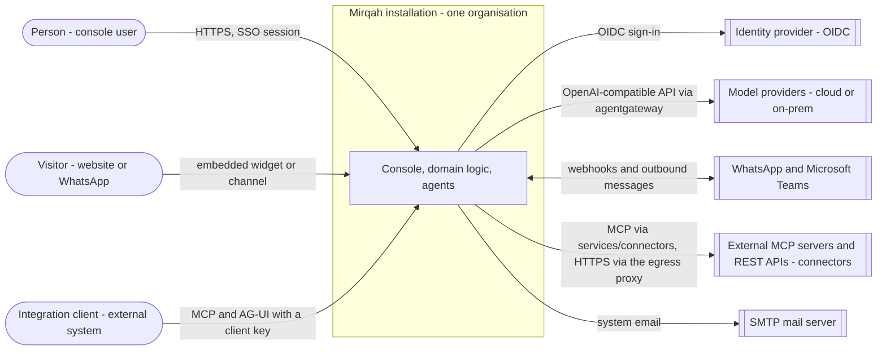
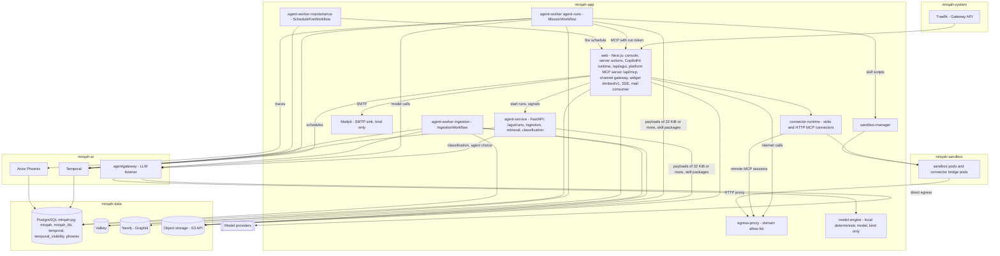

# Architecture overview

| Item | Value |
| --- | --- |
| Purpose | The system in context, its containers and who owns which data |
| Audience | Architects, new developers, technical stakeholders |
| Related | [Tech stack](tech-stack.md) · [Solution design](solution-design.md) · [AI platform](ai-platform.md) · [Security](../06-security/security.md) · [Agent runtime](agent-runtime-spec.md) · Decisions · [Deployment](../08-devops-and-deployment/deployment.md) |
| Last verified against code | 2026-10-29 |

## In one paragraph

The Next.js application (`apps/web`) owns all domain data in PostgreSQL and is the only workload
that connects to the domain database `mirqah`. The Python agent service (`services/agent`) runs every
agent mission as a Temporal workflow, so a mission survives a restart and a mission waiting on a
person holds no worker. Model calls leave the agent service only through **agentgateway**. When an
agent reads or changes domain data it calls the platform MCP server inside the web application with
its run token, so it passes the same permission check and writes the same audit a person does.
Knowledge is indexed into pgvector passages (database `mirqah_kb`) and a Graphiti graph on Neo4j;
traces go to Arize Phoenix; files, artifacts and large Temporal payloads go to object storage over the
S3 API; live updates and the system mail queue go through Valkey. Everything runs on Kubernetes, with
kind locally and the same Helm charts in Test and Live.

The platform decisions behind this are [AD-01 … AD-20](../03-decisions/platform-decisions.md); the agent runtime's
are in [harness-decisions.md](../03-decisions/harness-decisions.md).

## System context

Each external system is described in 06-integrations.

## Containers

Workload names, images and replica counts are listed in [deployment](../08-devops-and-deployment/deployment.md).
The diagram shows the current paths. agentgateway's MCP and A2A gateway roles are a target design
with no traffic today; see [AI platform](ai-platform.md#agentgateway).

### Responsibilities

| Container | Source | Responsibility |
| --- | --- | --- |
| `web` | `apps/web` | Console screens; domain logic and authorisation in feature services; server actions; the CopilotKit runtime (`/api/copilotkit`) and the AG-UI route that assembles runs (`/api/agui/[agentCode]`); the platform MCP server (`/api/mcp`); channel endpoints and the embedded widget (`/embed/v1`, D231); SSE live channels; the system mail consumer, which reads the Valkey stream `mirqah:mail` and sends over SMTP (D240); rendering of agentgateway model routes; the `db-migrate` and `object-buckets` hook Jobs |
| `agent-service` | `services/agent` (`mirqah_agent.main:app`) | AG-UI run endpoints, run stream relay from Valkey, signals (approve, answer, cancel), knowledge ingestion, removal and retrieval endpoints, request classification (`/classify/request`), the room agent choice on the Decision route `agent-choice` (`/classify/agent`, D290), document extraction. Reachable only from `web` |
| `agent-worker` × 3 | `services/agent` (`python -m mirqah_agent.worker <queue>`) | One Deployment per Temporal task queue: `agent-runs`, `ingestion`, `maintenance`. The `setup` worker and its workflows are removed with the Setup Director (D371) |
| `connector-runtime` | `services/connectors` | Runs connectors as MCP servers; creates one bridge Pod per stdio connector; opens remote MCP sessions through the egress proxy, with credential headers it holds in memory only (D296, D297). See [its README](../../services/connectors/README.md) |
| `sandbox-manager` | `services/sandbox` | Runs in `mirqah-app`; creates, executes in and destroys the sandbox Pods in `mirqah-sandbox` where a run's skill scripts run (D209). See [its README](../../services/sandbox/README.md) |
| `model-engine` | `services/modelstub` | Deterministic OpenAI-compatible engine for local runs and tests; disabled by default, enabled in `values-local.yaml` |
| `egress-proxy` | `ubuntu/squid` image | The route out for connector and sandbox Pods (`EGRESS_PROXY_URL`), for the connector runtime's remote MCP sessions (D297), and for the web app's requests to the internet (`lib/egress.ts`: OpenAPI connector calls, OAuth, channel outbound, skill import by URL, model connection tests, D234); holds the domain allow-list, which the local kind values switch off (`egressProxy.allowAll`, D297). agentgateway reaches model providers directly under its own NetworkPolicy |
| Mailpit | `infra/kind/mailpit.yaml` | SMTP sink for the platform's email, on the local kind cluster only (D240) |

## Data ownership

| Data | Owner | Store |
| --- | --- | --- |
| Every domain record: organisation, projects, requests, work items, rooms, agents, runs, approvals, budgets, audit | `web` | PostgreSQL database `mirqah` (role `mirqah_app`); see [data model](overview.md) |
| Passage vectors for Vector retrieval | agent service | PostgreSQL database `mirqah_kb`, table `passage` |
| Knowledge entities and facts | agent service | Neo4j through Graphiti, one group per collection (`kc_<id>`) |
| Mission execution history: steps, signals, timers | Temporal | Databases `temporal`, `temporal_visibility` |
| Durable business timers: reminders, expiries, SLA countdowns (fired on a Temporal Schedule tick, ADR-0005) | `web` | Table `core.timer` in `mirqah` |
| LLM traces | Phoenix | Database `phoenix` |
| File, artifact, attachment, skill package and raw document content | `web` and the ingestion worker | Object storage, buckets `raw-docs`, `files`, `artifacts`, `attachments`, `skills`, `memory`, `branding` |
| Temporal payloads of 32 KiB or more, encrypted by the codec first | agent service and workers | Bucket `run-payloads`; objects expire after 30 days (D81, D287) |
| Live fan-out, run event streams (`run:<id>:agui`), the system mail job stream (`mirqah:mail`) | `web` and agent service | Valkey (ephemeral; the mail notices themselves are rows in `gov.mail_notification`, D240) |

**Ownership rule.** Only `web` connects to `mirqah`. The agent service changes domain data only
through the platform MCP server under the run token's identity, so an agent passes the same
permission check, validation and audit as a person. `mirqah_kb` and Neo4j are rebuildable indexes;
Temporal and Phoenix hold execution state and traces. Losing any of those costs time, not data.

## Where to go next

| To understand | Read |
| --- | --- |
| Every technology and its version | [tech-stack.md](tech-stack.md) |
| How a request and an agent mission flow through the containers | [solution-design.md](solution-design.md) |
| agentgateway, Temporal, Phoenix, knowledge, sandboxes | [ai-platform.md](ai-platform.md) |
| Who an agent run calls, with protocol, credential and network rule per hop | [agent-communication.md](agent-communication.md) |
| Identities, trust boundaries and controls | [security.md](../06-security/security.md) |
| What an agent mission does and how it ends | [agent-runtime-spec.md](agent-runtime-spec.md) |
| The features each screen offers | [05-modules](../01-product-requirements/specs/README.md) |
