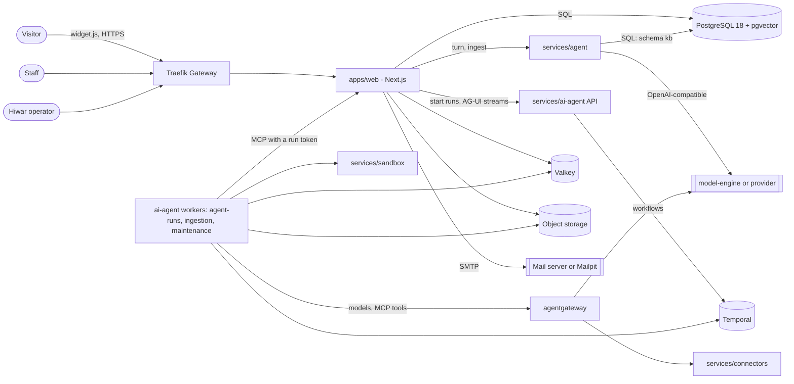

# Architecture overview

Hiwar is a multi-tenant SaaS on Kubernetes ([tech stack](tech-stack.md)). One Next.js application (`apps/web`) serves the public site, the control panel, the operator portal, the widget and its API, and the platform MCP server. Two Python services do AI work:

- `services/agent` (Hiwar): one turn of a customer agent for the website widget, and knowledge preparation and retrieval for customer sources.
- `services/ai-agent` (the AI capabilities module): the platform agents that the operator portal's AI capabilities configure, run as Temporal workflows, with tools reached through the platform MCP server and models and connectors reached through agentgateway.

## Containers

## Ownership of data

| Data | Owner | Store |
| --- | --- | --- |
| Organizations, members, sessions, customer agents, versions, deployments, conversations, messages, ownership history, tool calls, usage, plans, invoices, audit | `apps/web` | PostgreSQL schema `public` |
| Customer knowledge chunks and embeddings | `services/agent` | PostgreSQL schema `kb` (pgvector) |
| Customer knowledge files | `apps/web` writes, `services/agent` reads | Volume at `FILES_DIR` |
| Platform agents, versions, skills, connectors, memory, knowledge collections, models and routes, runs, approvals, channels, embedded deployments and their conversations | `apps/web` (AI module features) | Schema `ai` |
| Budgets, integration clients, feature flags, the agent kill switch, settings versions | `apps/web` | Schema `gov` |
| The AI module's audit trail (append-only by trigger) | `apps/web` | Schema `audit` |
| Module passage vectors | `services/ai-agent` | Database `hiwar_kb` |
| Module files, skill packages, large run payloads | `apps/web`, `services/ai-agent` | Object storage |

People in the AI module are Hiwar staff accounts with a platform role (`core.person` is a view over `users`); an org unit is a customer organization (`core.org_unit` is a view over `organizations`). The module's TAWP work-domain tables (`work.*`: projects, rooms, requests, work items) exist only so its queries run unchanged; they stay empty.

Neither agent service writes domain tables directly. Hiwar's widget agent returns the events of a turn and the web application persists them, so the single-owner rule ([INB-002](../01-product-requirements/specs/inb/002-conversation-ownership/spec.md)) is enforced in one place; the module's workers change data only through the platform MCP server, with the permission checks of the person a run acts for.

## Tenancy and identity

Every Hiwar domain row carries `org_id`, taken from the session (staff) or from the deployment key and origin (widget). The AI capabilities are platform-level: only staff accounts with a platform role and 2-step sign-in reach `/ops/ai`, and their grants come from that role (`db/queries/identity.ts`: a Platform admin holds every AI permission, a Support operator the read permissions).

## Environments

- Local: `make kind-up` brings up kind with the platform charts and the `hiwar` chart (profile `core` leaves out Neo4j and Phoenix). `compose.yaml` remains for running the web application on the host against PostgreSQL 18, Mailpit, the model stub and Hiwar's agent service.
- Staging and production: the same chart with `values-test.yaml` and `values-live.yaml` ([deployment](../08-devops-and-deployment/deployment.md)).
