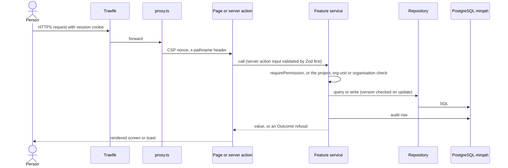
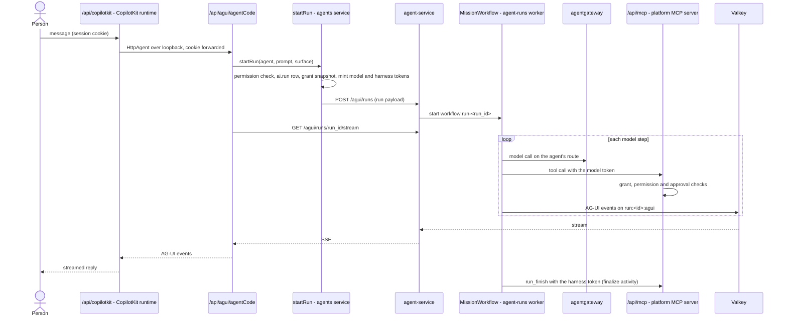
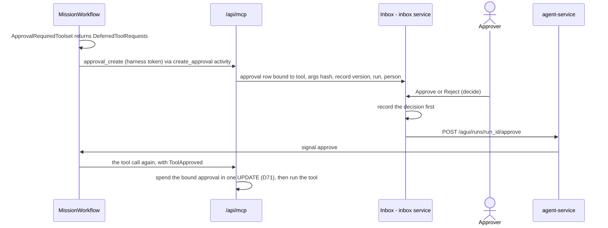
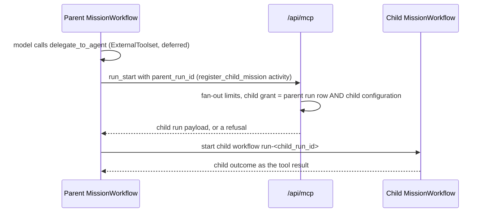

# Solution design

| Item | Value |
| --- | --- |
| Purpose | How the containers and modules work together: the request path, the agent path, the key flows, and the cross-cutting concerns |
| Audience | Developers, architects |
| Related | [Architecture overview](overview.md) · [Agent runtime](agent-runtime-spec.md) · [Security](../06-security/security.md) · [AI platform](ai-platform.md) · [Modules](../01-product-requirements/specs/README.md) · [Conventions](../10-user-and-developer-guides/conventions.md) |
| Last verified against code | 2026-10-29 |

## Web application structure

`apps/web/src` is organised by feature. Each of the 22 feature modules under `features/<feature>/`
has the same files (`tools.ts` only where the feature offers platform MCP tools, 16 of them), and an
architecture test (`apps/web/tests/architecture.test.ts`) enforces the layering:

| File | Holds | Rule |
| --- | --- | --- |
| `repository.ts` | Drizzle queries | The only file that imports the database client |
| `service.ts` (and `<topic>-service.ts`) | Business rules, permission checks, audit writes | The only place a permission check and an audit write live; the only caller of the repository besides the feature's actions |
| `actions.ts` | Server actions (`"use server"`) | Validate input with Zod, then call a service |
| `schema.ts`, `types.ts` | Zod schemas, types | |
| `tools.ts` | The feature's platform MCP tools | Registered into one catalogue (`src/mcp/tools.ts`) |
| `components/` | The feature's screens | Compose primitives from `components/ui` and `components/shell` |

Shared code lives in `lib/` (session, audit, crypto, objects, valkey, sse, temporal, run-token,
logger, env and others), `authz/` (the permission evaluator), `components/` (shared UI), `ds/` (the
design-system wrapper) and `i18n/`. These never import a feature. Routes in `app/` compose and hold
no business logic. The layout decisions are R01–R04 and R12 in
[code-structure.md](../03-decisions/code-structure-decisions.md); naming and testing rules are in
[conventions](../10-user-and-developer-guides/conventions.md).

## Request path

A person's screen read or change:



- `src/proxy.ts` sets a per-request Content-Security-Policy nonce, the response's `frame-ancestors`
  (the widget frame's from its deployment's allowed origins, D231) and the `x-pathname` header that
  sign-in uses to return a person to the same screen. It does no authentication.
- A server component reads through a service; a mutation is a server action. Every protected read
  and write is checked in the service, never only in the UI (NFR-09, `COM-08`).
- Nothing in the browser reaches the agent service (NFR-13).

## Agent path

Every agent, whether the Platform Assistant on the page panel, a room participant, a request-step or
work-item agent, a scheduled agent or an embedded deployment, runs on one generic runtime (D64).



- The browser never holds a token. `startRun` (`apps/web/src/features/agents/run-start-service.ts`)
  mints two short-lived JWTs (`lib/run-token.ts`, 30 minutes): a **model** token that carries the
  granted tools, and a **harness** token for plumbing only (`approval_create`,
  `agent_question_create`, `run_start`, `run_token_refresh`, `run_finish`) (D33). The workflow
  replaces both 25 minutes after they were minted through `run_token_refresh`, and takes the fresh
  pair the platform sends with each `approve` and `answer` signal (D82, D251).
- Only the assistant panel goes through CopilotKit. A room, a request step,
  a work item, a schedule, the playground and a widget visitor's free conversation call `startRun`
  directly; a room follows the run on `/api/sse/runs/[runId]` (D161).
- Temporal payloads are encrypted by the codec (D81, D204), and a payload of 32 KiB or more is kept
  in the `run-payloads` bucket with a reference in the history (`services/agent/src/mirqah_agent/temporal/storage.py`, D287).
- The context type (for example Console for the assistant panel) is derived on the server from the surface that started the
  run, never from the request (D53, D70).
- The mission's behaviour, outcomes and limits are specified in
  [agent-runtime-spec.md](agent-runtime-spec.md); the generic runtime is
  `services/agent/src/mirqah_agent/mission/runtime.py`.
- The outcome, with the run's timeline built from its messages (D300), is written back by the
  `finalize` activity through `run_finish`; `run-service.ts` `finishRun` records it, for a room it
  posts the reply (`features/rooms/reply-service.ts`), and for a widget conversation it writes the
  answer into the transcript (`features/engage/visitor-agent.ts`, D221).

## Key flows

### Approval round trip

A tool whose tier is T2 for the run pauses the mission until a person decides.



- The binding, expiry and single use are enforced by the server, never by the library (D20, D21,
  D49, D84). A call whose arguments or target record changed after approval is refused.
- The pause is 24 hours (D95). An approval nobody decides becomes `ToolDenied("nobody approved this
  call in time")` and the mission carries on (D126). The mission allows 20 approval rounds (D89).
- Decision first, signal second (`lib/agent-runs.ts`): a decision that was recorded and not
  delivered can be re-sent; a mission resumed on an unrecorded decision cannot be undone.
- The approver is decided by the server (`lib/approval-binding.ts`). In a room and in the assistant
  panel it is the person who asked, who decides without needing `approvals:decide` (D105, D269,
  D281, D284); in a room a call marked `authorisation` goes to the other holders of
  `approvals:decide` instead (D253). Elsewhere the approvers are the holders of `approvals:decide`
  other than the requester whose grant covers the run's project (D330). A person decides only from
  their own Inbox item (D243). A change request reaches the model as a correction, not a refusal
  (D285), and the panel's approval mode Auto approves what the person asking would decide (D282).

### Asking a person

`ask_person` is answered by the workflow itself (D125): the `create_question` activity records the
question through `agent_question_create`, the person answers in the Inbox, the web app signals
`answer`, and the answer, or "nobody answered the question in time" after 24 hours, becomes the tool
result.

### Delegation to another agent



A refused delegation is a tool result, not a failed mission: the model is told why and does the work
itself (D103, D114). Limits: 8 delegations per run, 3 in flight, and no child more than 2 hops
below the mission a person started, all refused in `registerDelegatedRun` (D15, D103, D142).

### A mention in a discussion room

`features/rooms/message-service.ts` posts the message, notifies mentioned people, and asks
`turns.ts` which agent answers. One agent acts on a message: the first agent it names, or, in an
Autonomous room, for a message that names nobody, the room's one agent or the one the agent service
chooses on the Decision route `agent-choice` (`agent-choice.ts`, `/classify/agent`, 15 s; the lead
agent answers when no valid choice comes back) (D213, D289, D290). A message naming only people
starts nothing. `startRun` is called with the room surface and the recent conversation; each address
is its own mission whose requester is the person who wrote (D66). Reads in a room are bounded by what
every human member may see, except `knowledge_search`, which is bounded by the agent's grant (D104,
D291). A room note says why no agent answered when the room is not active, the hop limit or the room
cost cap is reached, or the message names somebody who is not in the room. When the run finishes, a
`Succeeded` run's output is posted as the agent's reply and any other outcome as a System failure
naming the agent; every participant's screen updates through the room's SSE channel, and the reply
streams in from the run's stream while it is written, its tool calls as steps, which the posted
reply keeps from the run's timeline (D161, D352).

### Scheduled work

A scheduled work item is a Temporal Schedule (`schedule-<id>`, `lib/temporal.ts`). When it fires,
`ScheduleFireWorkflow` on the `maintenance` queue calls
`POST /api/maintenance/schedules/[id]/fire` with `MAINTENANCE_API_TOKEN`, and the web app creates the
work item or request. See scheduled work.

### Embedded widget

```mermaid
sequenceDiagram
  participant HP as Host page
  participant LD as /embed/v1/widget.js
  participant FR as /embed/v1/frame/code
  participant API as /embed/v1/sessions
  participant RS as startRun
  HP->>LD: script tag with data-deployment
  LD->>API: GET /embed/v1/config/code?host=origin
  API-->>LD: 403 for a page the deployment does not allow, so no launcher is drawn
  LD->>FR: iframe; frame-ancestors from the deployment's allowed origins
  FR->>API: POST /embed/v1/sessions (origin checked), then messages and actions with the session token
  API->>API: storyline step, or the deployment's agent for an off-script reply
  API->>RS: runAs(run-as person) startRun(surface Deployment)
  API-->>FR: blocks over /embed/v1/sessions/id/stream (SSE)
```

A session token is an HS256 JWT under a key derived from `AUTH_SECRET`, valid 30 minutes and renewed
on every answer (`features/engage/widget-session.ts`). Messages are blocks built from the stored
transcript (`protocol.ts`); the storyline engine is `storyline.ts`, which runs a storyline Guided or
Strict (D339). A Guided reply that is none of the step's choices, and a conversation on a deployment
with no published storyline, go to the deployment's agent, which runs as the deployment's run-as
person with the agent's grant (D221); its answer is written into the transcript when the run
finishes. A person holding `conversations:answer` can take a conversation over from the
Conversations screen; the agent's reply is then dropped (D342, D343). The specification is
embedded-widget-spec.md (D231).

### System email

The change that raises, moves, returns or finishes a request, or finishes a work item, writes one
`gov.mail_notification` row per recipient in the same transaction, for each template switched on
(D240, D247). After commit the row ids go onto the Valkey stream
`mirqah:mail` (`lib/valkey.ts`); a consumer in each web process (group `mailers`, started from
`instrumentation.ts`) and a sweep every minute claim a row, render the template in the recipient's
language and send it over SMTP (`lib/mailer.ts`), recording Sent, Failed, or Queued again after a
transient failure. The row is the durable record, so a job Valkey loses is sent by the sweep. The
agent tool `email_create` (T2) uses the same queue (D242); invitations (D248) send through the same
mailer.

## Cross-cutting concerns

### Authentication

People sign in with the built-in email and password or with UAE PASS (D387, `features/auth/`); the
console opens the session rows itself and Auth.js v5 reads them (`src/lib/auth.ts`,
`src/db/auth-adapter.ts`); passkeys are managed from My profile. Only an Active person signs in. An
invited person accepts an emailed link (`/invite/[token]`) by choosing a password, which spends an
open, unexpired (7 days), unused invitation (`lib/invitation.ts`, D248). UAE PASS is linked to a person
by their Emirates ID, or once with their password. Agent missions, integration clients, visitors, channel providers and the scheduler each have their
own credential; the full list, with who verifies each, is in
[security: identities](../06-security/security.md#identities). See
[identity and sign-in](../04-api-and-integrations/identity-provider.md).

### Authorisation

- **Permission sets, never role names; explicit deny wins.** Role assignments flatten into grants
  per permission and scope (Organisation, OrgUnit or Project); `authz/evaluate.ts` answers "may
  this principal do this, here". `lib/session.ts` exposes `requirePermission`, `can` and the visible
  project and org-unit lists that queries filter by.
- **A scoped role applies only in its scope (D330).** `requirePermission(permission)` answers whether
  the person holds the permission at all. A record that belongs to a project is checked with
  `requireProjectPermission`, one that belongs to an org unit with `requireOrgUnitPermission`
  (evaluated against that unit's path), and a change to what every unit uses with
  `requireOrganisationPermission`.
- **Agents act as the person, bounded by the grant.** Effective permission is the person's
  permission AND the agent's grant (D31). The grant is recorded on the run row
  (`ai.run.granted_tools`, D35), shown in `tools/list` and re-checked on `tools/call` (D29, D30).
  Refusals carry a reason code: `agent_grant`, `run_binding`, `approval_required`, or
  `user_permission` for the person's own permission, whose reason starts `room_read_floor` when a
  room's read floor refused it; the floor bounds the model token's reads only, not the harness
  token's plumbing (`src/mcp/server.ts`, D32, D69, D104, D360).
- The privileges and the seeded roles are listed in the
  [organisation data dictionary](../05-data/data-dictionary/organisation-and-identity.md).

### Errors

- A refusal a person must read is a returned `Outcome` (`src/lib/outcome.ts`), because Next.js
  replaces a thrown server error's message with a digest in production. Only the unexpected is
  thrown.
- The screen raises a refusal with `orThrow`/`Refused` and shows it in the console-wide toast
  through `hooks/use-action.ts`; field validation stays on the form.
- Route-level error boundaries (`app/(console)/error.tsx`, `app/(mirqah)/error.tsx`, and `app/global-error.tsx`
  for a root layout that fails) show a non-technical message (`COM-06`); `instrumentation.ts` `onRequestError` logs each server error as one JSON line.
- Concurrent edits: every mutable row carries `version`; a stale write is rejected (`COM-10`). An
  agent's partial edit names `expectedVersion` in the SQL `WHERE` (D59).

### Audit

Every change writes an audit row through `lib/audit.ts` with the actor (Person, Agent, Client or
System), action, object and time (`COM-18`). The `audit` schema is insert-only with a guard trigger
and monthly partitions (`infra/postgres/03-partitions.sql`, `04-audit-guard.sql`). Recording the
mission id on every agent write is an open task (D26).

### Logging and diagnostics

| Service | Logger | Notes |
| --- | --- | --- |
| `web` | pino, `src/lib/logger.ts` | JSON to stdout, `base: { service: "mirqah-web" }`, level from `LOG_LEVEL`, redaction of secret-like and personal fields before the line is written |
| Python services | structlog | JSON to stdout with bound run and step context |

The cluster collects stdout; the Logs screen reads it. Run events, Temporal history and Phoenix
traces are covered in [AI platform](ai-platform.md#observability).

### Live updates and caching

Valkey carries pub/sub channels (`room:<id>`, `inbox:<person>`, `dash:<scope>`,
`conversation:<id>`, `conversations`; `channels` in `lib/valkey.ts`), one stream per run
(`run:<id>:agui`) and the mail job stream (`mirqah:mail`). The SSE routes under `/api/sse/`
(`dashboard`, `inbox`, `rooms/[roomKey]`, `runs/[runId]`, `conversations`, `conversations/[id]`)
subscribe and forward. A run's stream replays from `Last-Event-ID`, each follower reading on a Valkey
connection of its own (D350), and is given only to the requester, a holder of `agents:read`, or, for
a room run, whoever may read the room (D124, D161). The conversation streams need
`conversations:read` and carry no visitor text on the console-wide channel (D343, D344). Without
Valkey the routes answer 501, so the browser stops reconnecting rather than holding open a stream
that carries nothing (`lib/sse.ts`).

### Localisation and theming

Mirqah screens take their strings from keyed per-feature catalogs (`defineMessages({ key: ["English",
"العربية"] })`, with `{name}` placeholders and Arabic plural forms), translated with `getT(catalog)` in
server components and `useT(catalog)` in client components (M-017, C-09). The request language comes
from the `mirqah.lang` cookie the top bar's EN | عربي switch writes; the shared document (`app/root-document.tsx`,
rendered by both root layouts, ADR-0010) puts `lang` and `dir` on `<html>` from it, so the first render is already right to left in Arabic. Numbers, dates (Gregorian and
Umm al-Qura Hijri) and money are formatted with Western digits in both languages, dates and times in the viewer's
profile time zone (`getTimeZone`/`useTimeZone`, Asia/Dubai by default, M-000s) (`src/i18n/format.ts`;
money through `src/lib/money-format.ts`). `<Ltr>` isolates numbers, formulas, codes and IBANs inside
Arabic text. The reviewed Arabic seed strings are `src/i18n/glossary.ts`, generated from the handoff's
`ar-glossary.json`. Kept console screens still use the inline `t(en, ar)` helper until they are rebuilt.

### Design system

The product stylesheet is the handoff's `src/styles/mirqah-ui.css` with `mirqah-tokens.css` (ADR-0003),
loaded by the shared document of both root layouts (ADR-0010) with Inter, Poppins, IBM Plex Sans Arabic and JetBrains Mono self-hosted
through `next/font` (`src/styles/fonts.ts`). Components render its class vocabulary:

| Folder | Holds |
| --- | --- |
| `components/ui/` | One primitive per file: Button, LinkButton, Icon, Badge, Card, Tabs, Segmented, Chip, Switch, Alert, Note, Toast, Dialog, Drawer, Menu, Stat, Progress, Avatar, Field, Input, Select, Textarea, EmptyState, Skeleton, PageHead, Breadcrumbs, TimerAnnouncer |
| `components/shell/` | `AppFrame` (skip link, Sidebar, Topbar, `<main class="content">`), the sidebar's groups per persona and workspace kind (`nav-definitions.ts`, filtered by `canOpen` from the screen registry), workspace switcher, language switch, notifications, account menu, service status |
| `components/shell/record-table/` | `RecordTable` (BR-LST list bound to the address), `RecordTableView`, `TableSearch`, `TablePager`, `FixedGrid`; `src/lib/list-response.ts` is the route-handler side |
| `components/legacy/` | The previous console's components and stylesheets, imported only by the kept screens' route groups until they are rebuilt |

The shell renders only what `ShellContext` (`src/lib/shell-context.ts`) gives it; actions (sign out, mark
all read, search, assistant) are injected as server actions. Accessibility rules live in the kit:
focus trap and restore in dialogs and drawers, menus that close on outside click, scroll, Escape and after
an action, `role="status"` regions for toasts and list status, timers announced only at intervals
(`useIntervalAnnouncer`, BR-ACC-03), 44 px targets on coarse pointers and reduced motion in the stylesheet.
The token contrast matrix (`src/styles/token-contrast.ts`) is tested at 4.5:1 (AC-Brand-01). A dev-only
preview, `/_dev/shell?persona=…&kind=…&lang=…`, renders the shell with fixture contexts and answers 404
in production builds.

### Secrets and configuration

Configuration is read and validated once in `src/lib/env.ts` (web) and `config.py` settings (Python).
Provider, connector, channel and SMTP credentials are envelope-encrypted with `APP_KEK`; Temporal
payloads are AES-GCM encrypted under `TEMPORAL_CODEC_KEY`, with earlier keys kept for decryption in
`TEMPORAL_CODEC_PREVIOUS_KEYS` (D81, D204), and those of 32 KiB or more are stored, encrypted, in the
`run-payloads` bucket (D287). See [security](../06-security/security.md) and
[configuration](../08-devops-and-deployment/configuration.md).
