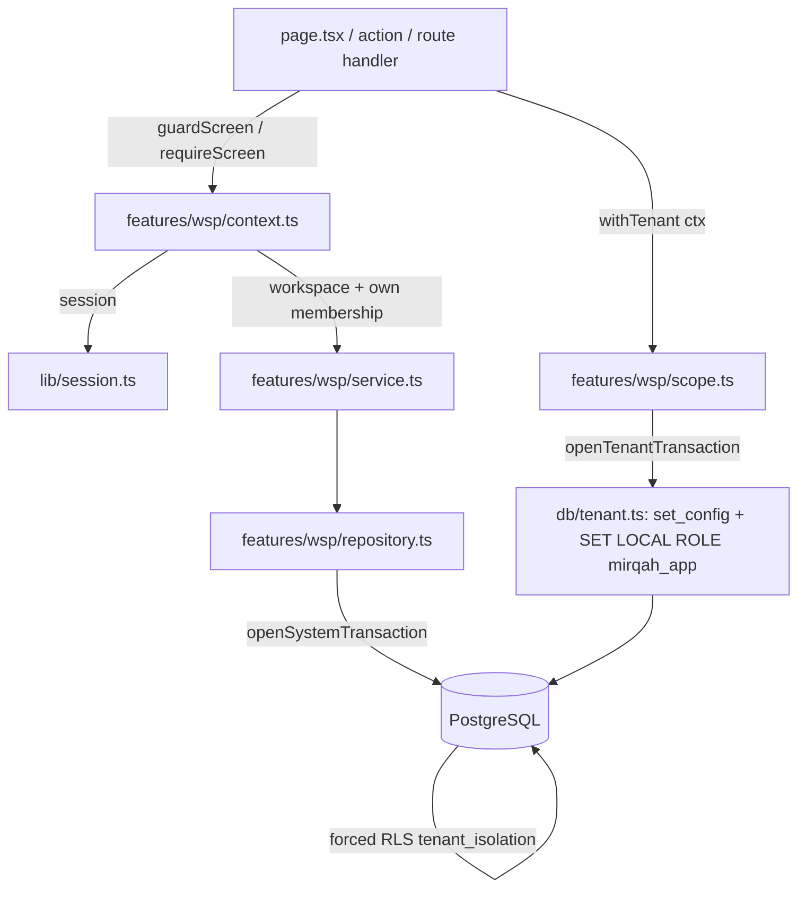

# Tenancy, request context and isolation

How ADR-0003 "Tenancy and isolation" is built in `apps/web`. Data tables: [05-data workspaces and
tenancy](../05-data/data-dictionary/workspaces-and-tenancy.md). Security view (RLS, roles):
[06-security tenancy and roles](../06-security/tenancy-and-roles.md).

## Layers

| Piece | File | Does |
| --- | --- | --- |
| Public API | `src/lib/tenancy.ts` | Re-exports everything below; the one import path for modules |
| Transaction openers | `src/db/tenant.ts` | `openTenantTransaction`, `openPlatformTransaction`, `openSystemTransaction`: one transaction, `set_config('mirqah.tenant_id' / 'mirqah.user_id' / 'mirqah.scope', …, true)`, `SET LOCAL ROLE mirqah_app` |
| Context | `features/wsp/context.ts` | `resolveWorkspace({route}|{host})`, `guardScreen(ws, screenId)` → `granted` + `RequestContext` or `denied` + reason, `requireScreen` (throws `NoAccessError`) |
| Scope | `features/wsp/scope.ts` | `withTenant(ctx, fn)`, `withPlatform(ctx, fn)` (operators in `ops` only); for the kept knowledge console `withConsolePlatform(personId, fn)` and `withOwnerTenant(tenantId, personId, fn)` (M-037d) |
| Isolation | `features/wsp/service.ts` | `notFoundOrIsolation(ctx, table, id)`: 404 always, `isolation.alert` in `audit.platform_entry` when the id is another tenant's |
| Authorisation | `features/wsp/access.ts`, `service.ts` | `requireRole` (deny by default), `operatorAccess` (§4.8), `canSeeLearner`, `taughtClassIds`, `usesSeat` |
| Shell | `features/wsp/shell.ts` | `loadShellContext(ws, persona)` → `ShellContext` (`src/lib/shell-context.ts`) |
| Audit | `src/lib/tenancy-audit.ts` | `audit(ctx, entry, tx?)` tenant log, `platformAudit(entry)` platform log |
| Errors | `src/lib/tenancy-errors.ts` | `NoAccessError` 403, `RecordNotFoundError` 404, `InvalidTransition` 409 via `toHttpError` |
| State machines | `src/lib/state-machine.ts` | `defineMachine`, `transition`, `runTransition(machine, move, hooks)`; SM-01 in `features/idn/machines.ts` |
| Config and clock | `src/config/store.ts`, `src/lib/clock.ts` | `getConfig(key, at?)`, `publishConfig`, `configHistory`; `now()` honours `MIRQAH_NOW` |

## Request flow

1. The `{ws}` path segment (or a verified custom domain) names the workspace. It is a hint only.
2. `guardScreen` reads the signed-in person (`requireSession`), the workspace and the person's own
   membership of it in one system-scope transaction. Unknown workspace → 404. No active membership,
   or the screen's roles / workspace kind / module do not match (`canOpen` in `src/lib/screens.ts`) →
   `denied`; the page renders "You don't have access" and reads no data (AC-ALL-01). Pages render the
   refusal instead of throwing, so no error boundary logs it.
3. Every read or write of a tenant table runs in `withTenant(ctx, …)`. Repositories receive the
   transaction and also filter by `tenant_id` (second layer).
4. A lookup that finds nothing calls `notFoundOrIsolation`; the caller gets the same 404 whether the
   id is unknown or another tenant's (AC-ALL-02).

## Workspaces and personas

- Customer tenants: type `school` / `company` (BR-TEN-06), kinds per BR-TEN-07.
- Platform workspaces (C-08) are rows with fixed ids, isolated like tenants: `learn` (consumer, the
  registry's `consumer` kind), `studio` (the AI creators' marketplace workspace), `ops`.
- A membership holds roles (`Role` in `src/lib/screens.ts`); the switcher opens each membership in the
  persona its roles land in (`primaryPersona`: operator, admin, supervisor, student).

## Transitional rule for the kept AI tables (C-02)

The kept AI tables that hold tenant data (memory, knowledge, runs and steps, approvals, inbox,
assistant chats, the tenant audit log) now carry `tenant_id` under the same forced policy. Their code
does not pass a tenant yet, so the column defaults to the transaction's tenant and otherwise to the
`ops` workspace, and their repositories still use the pool. In a cluster the database-owner login gets
`mirqah.scope = platform` as its default (`07-tenancy.sql`) so those screens keep working; tenant
transactions override it locally. M-026 moves them under `withTenant`/`withPlatform` and removes the
default. The architecture test forbids the pool in Mirqah module repositories that touch a tenant table, and in the
knowledge repository, which since M-037d writes in the collection owner's tenant transaction (decision-log #158).

## Testing

- DB suites (`apps/web/tests/wsp/`): RLS denies cross-tenant reads and writes as `mirqah_app`, every
  `tenant_id` table has a forced policy and a `tenant_id`-led index, `withTenant` sets the context,
  screen guards (AC-ALL-01), isolation alert (AC-ALL-02), attribute rules, append-only audit, config
  versions, seed contents.
- Cross-tenant harness: `expectCrossTenant404(call, id)` in `tests/wsp/support.ts`; tests claim an
  endpoint with `[XT:<id>]`; `npm run isolation:coverage` writes
  [isolation-coverage.md](../07-testing/isolation-coverage.md) (`--check` fails on a gap).
