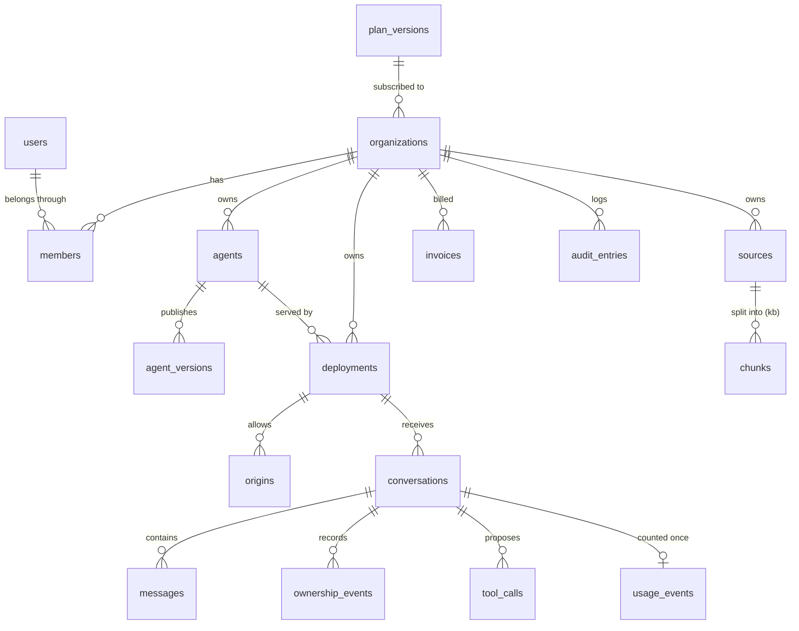

# Data model

All tables are in one PostgreSQL 18 database. Hiwar's tables are in `public` and `kb` (below). The AI capabilities module adds the schemas `ai` (agents, versions, skills, connectors, memory, knowledge collections, models and routes, runs, approvals, channels, embedded deployments and their conversations), `gov` (budgets, integration clients, feature flags, the agent kill switch, settings versions), `audit` (the module's append-only audit trail), `core` (calendars, the organisation settings row, groups, external contacts, and the views `core.person` over `users` and `core.org_unit` over `organizations`) and `work` (the module's TAWP work-domain tables, kept empty). Their definitions are `apps/web/src/db/schema/{ai,gov,audit,core,work}.ts`; migrations 0004 to 0007 create them with the module's database rules (audit guard, approver independence, tool-mode tier, budget windows, automatic version increment).

In Hiwar's own tables every domain table carries `org_id`; the only cross-organization tables are `users`, `plan_versions`, `operator_actions` and `sales_requests`. Column definitions are in [data-dictionary.md](data-dictionary.md).

## Rules the schema carries

| Rule | Where |
| --- | --- |
| One owner per conversation; every ownership change increases `conversations.version` | `conversations.state`, `owner_user_id`, `version`; changes are guarded updates in `apps/web/src/server/inbox.ts` |
| An AI conversation is counted once | `usage_events.conversation_id` is unique |
| Published agent versions do not change | `agent_versions` rows are only inserted; edits change `agents.draft` |
| A conversation keeps the agent version it started with | `conversations.agent_version` |
| Audit entries are never edited or deleted | no update or delete path exists for `audit_entries` |
| Usage alerts fire once per period and threshold | `alerts_sent` primary key `(org_id, period, threshold)` |
| Plan versions are kept; subscriptions point at one | `plan_versions (plan, version)` unique; `organizations.plan_version_id` |
| Knowledge chunks belong to one organization and source | `kb.chunks.org_id`, `source_id`; retrieval filters on both |
